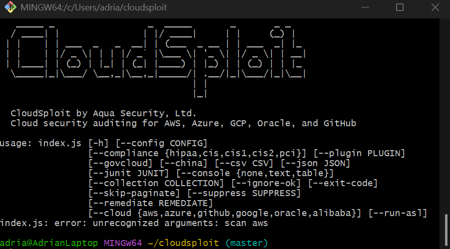

# T4.3 - Automatic Vulnerability Scanners

Wednesday, 18 Mar 2026

*Originally published on my UNSW OpenLearning blog.*

I have decided to use CloudSploit as it sounds pretty cool as it has "sploit", reminding me of Metasploit, a pen test software. It's also quite easy to setup, with only a command that I run in git. Furthermore it checks alot of security risks for AWS such as IAM permissions, bucket policies , EC2 configurations and VPC misconfigurations!

CloudSploit

I first installed node.js as it was necessary through the website, as well as cloning the github onto my git. Once it was all downloaded and set up, I simply went back to my AWS console and created a new IAM role.

Due to a sudden restriction in my permissions, I wasn't able to create IAM roles anymore as my server regions were locked. However if I had permissions, I would have approached it like this.

First, create an IAM role with the policy ReadOnlyAccess and StudentPermissionsBoundary.

Second, allow it so I can assume the role.

Then after that I would export the credentials like ACCESS KEY, SESSION TOKEN etc and run node index.js scan aws in CloudSploit, which will call my APIs, read my resources and analyse configs.
