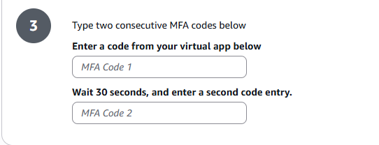
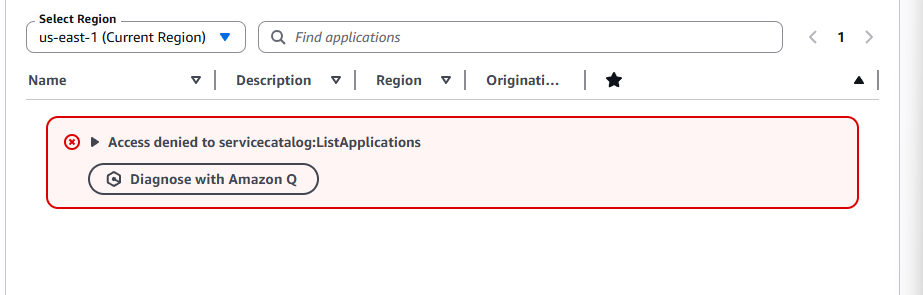

# TASK 2.0B - Get ready to use AWS Management Console

Tuesday, 3 Mar 2026

*Originally published on my UNSW OpenLearning blog.*

Through following the instructions

- [Login to your student user account with your emailed AWS credentials](https://docs.aws.amazon.com/IAM/latest/UserGuide/id_users_sign-in.html)

- [Enable MFA on your student user account](https://docs.aws.amazon.com/IAM/latest/UserGuide/id_credentials_mfa_enable_virtual.html)

I was able to access my AWS account and enable MFA on my account. The overall interface of AWS is quite confusing in my opinion and took a while to navigate and find specific tabs.

What I found interesting was how they verified my MFA. Through setting it up, it told me to enter 2 consecutive MFA codes instead of 1 after scanning the QR code. I was very intrigued by this new security feature as I've never seen it before.

I found it interesting as it made me think about how AWS ensures you are properly synced up with the TOTPs, more specifically ensuring you aren't just guessing or reusing a valid code.

To counter against brute force attacks, a rate limit feature or something like this could stop / prevent these attacks with MFA codes.

After setting the MFA up, I navigated to the homepage. What I noticed was that most of the features AWS provides were removed for my account, with my account having limited permissions.  I tried to create a new application but was denied as I couldn't allocate any resources.

This reminded me of my tutorial where I was taught the Principle of Least Privilege, a cyber security concept where users, programs and systems are only given minimum access to ensure attacks are prevented. The access given is determined by what tasks are given to the users , programs or systems.

In this case, setting MFA was my authorised task and I could successfully do so. However, creating applications in AWS requires a higher level of access in which my account does not have.

