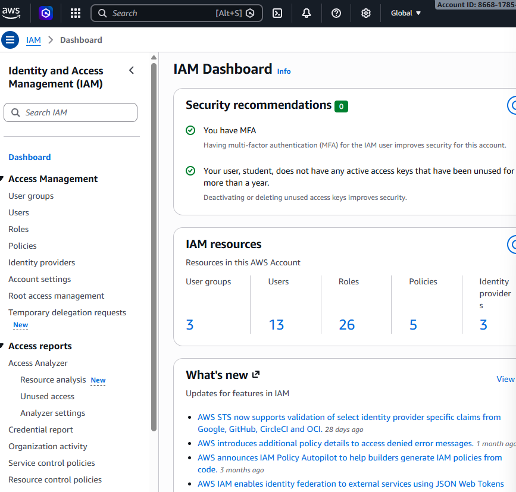
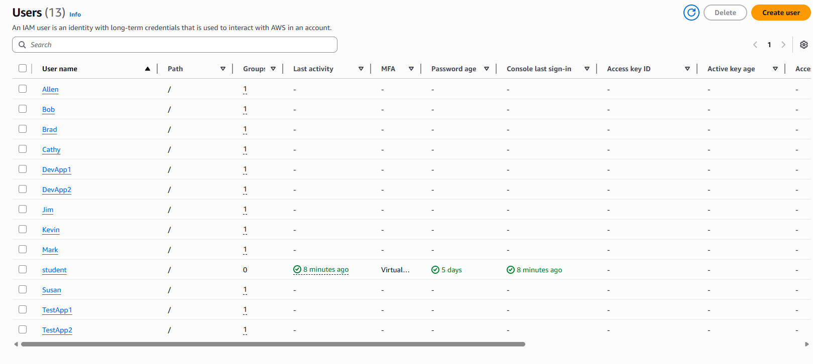
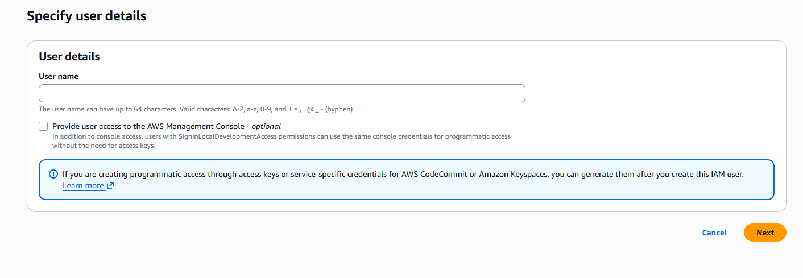
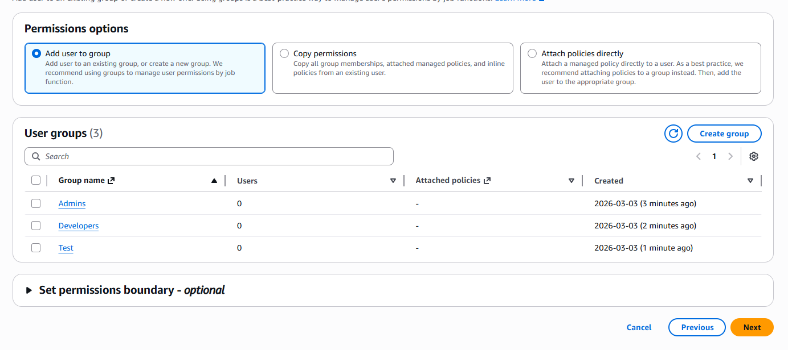

# TASK 2.2 – IAM Configuration

Tuesday, 3 Mar 2026

*Originally published on my UNSW OpenLearning blog.*

To successfully configure IAM in AWS, you first need to head over to your IAM Dashboard, you can do this by simply searching up "IAM" in the search bar.

Heading over I saw this page.

2. Head over to users

As you can see, I have created all 12 users, (13 including my student user that has linked to my MFA in the previous activity).

3. To create a user, click on create user on the top right.

4. Upon clicking, you will see this.

Simply enter the user name and click "Next".

5.

Now you have the option to select a group for the user to join, you can also create a new group. For this activity, I created Admins, Developers and Test to follow the diagram. Then I simply created 12 users with this progress and linked them with their designated group.

Overall, this activity was pretty easy and fun. It helped me learn about how to manage user control in a virtual cloud environment.

A "pitfall" I found was how the users tab won't tell you what the group the user is in, but the number of groups they are in. I found that to be pretty annoying and would much prefer the name of the group the user is in. That way, you don't have to manually click on the user to check what group they're in.
