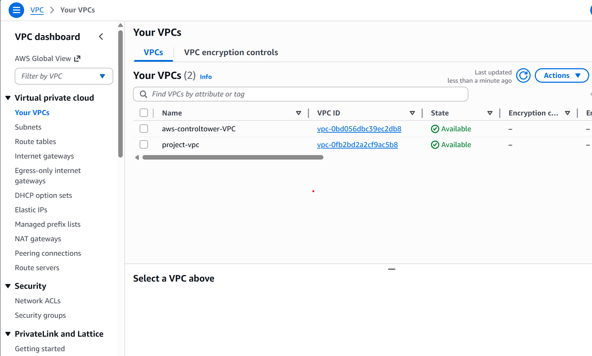
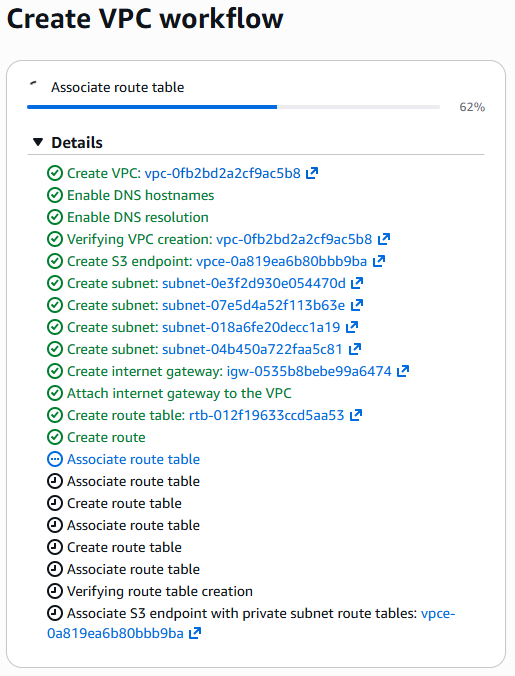
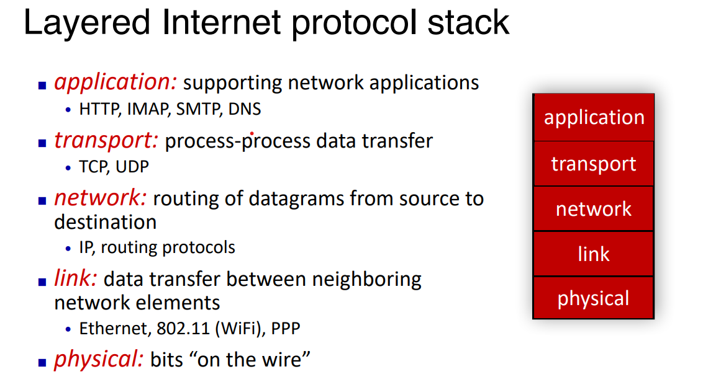

# TASK 4.1 - AWS Get Started with Networking & Compute

Wednesday, 18 Mar 2026

*Originally published on my UNSW OpenLearning blog.*

Virtual Private Cloud

I was able to create a VPC in AWS console. Here is how I did it.

I searched VPC in AWS console home, from there I was able to view my VPCs and create a new one.

From here, I was able to create a VPC workflow. Through this, I learnt about what IP and routing is. Basically routing is the process of ensuring the path you take from sending packets through networks is optimal, typically from a source to a destination.

Overall, it was quite simple but it got me thinking about implementing an EC2 instance inside my VPC. Basically having a bunch of virtual machines inside my virtual cloud server.

Internet:

Through reading through the slides, I have now learnt the general idea of how the internet works. The internet compromises of billions of computing devices known as "hosts", which are end systems.

When I access a website, my computer is the host running network apps at the "edge". The first thing I need to do to connect to the internet is to connect to my local network (Wifi). From this, I obtain an IP address using the DHCP also known as the Dynamic Host Configuration Protocol.

Dynamic Host Configuration Protocol:

This protocol's goal is to dynamically obtain IP address from the network my computer joins. It can renew its lease on addresses in use and allows the reuse of addresses. Think of this as a protocol that allows my computer to communicate with other devices on the internet.

Next, the browser needs to find the IP of the website I want to connect to. It does this through DNS, translating the domain name into an IP address. Once it's connected, it uses the Layered Internet architecture, implemented as a stack with layers and protocols.

From my understanding, the application layer is responsible for sending HTTPs requests. The transport layer uses TCP to ensure there is a reliable communication between hosts. The Transmission Control protocol ensures data integrity between applications. Next the network layer adds IP addresses to route the source to the destination, while the link sends the frames over through wifi and ethernet.

TLS can also be used to ensure the communication is encrypted and not intercepted, which is a must in cloud and cyber security.

Case study

The biggest case of a data breach due to misconfigured EC2 instances is the Capital One data breach in 2019. An unauthorised user was able to get access to all types of personal information about Capital One customers and individuals who had given sensitive information like their credit card details, addresses and names. This attack had unfortunately affected over 100 million individuals in the US and 6 million in Canada. Luckily there was no credit card accounts being compromised with only less than one percent of social security numbers were compromised.

This attack was possible due to vulnerabiltiies such as a misconfigured EC2 instance in AWS as well as Server-Side Request Forgery. Furthermore, the data was easily deencrypted, showing us how there were barely any security measures implemented.

From this, we can learn to enforce a ton of security measures as well as ensuring EC2 instances are not misconfigured. By applying classic principals such as the principle of least privilege and other security measures, we can ensure these attacks never happen again.

We can also implement remedies such as a more secure VPC configuration and implement logging and monitoring through intruder systems. Also since encryption was weak, we need to implement stricter and more secure encryption.
