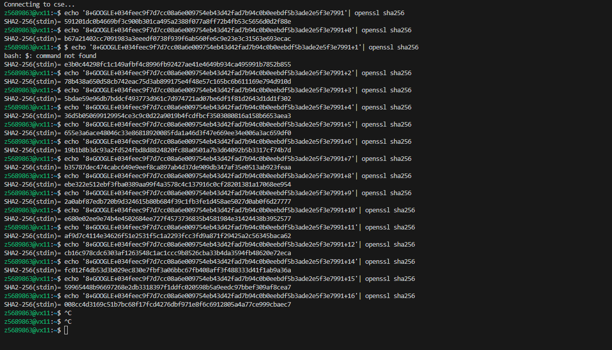
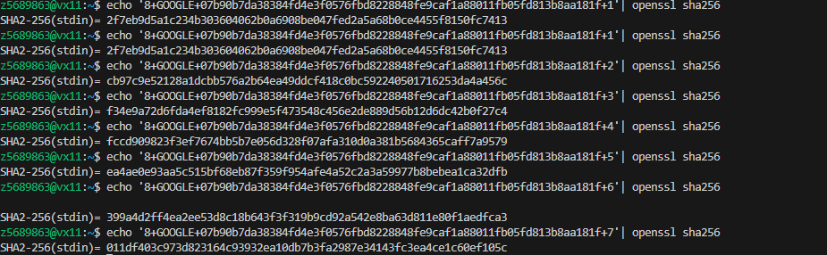

# BITCOIN MININGG

Sunday, 20 Apr 2025

*Originally published on my UNSW OpenLearning blog.*

So I first read the post and was super confused, so I read the post again and again and finally understood it.

I start by opening Visual Studio Code, creating a new file.

I open terminal and enter the following

'echo '8+GOOGLE+034feec9f7d7cc08a6e009754eb43d42fad7b94c0b0eebdf5b3ade2e5f3e7991'| openssl sha256'

It gave me back a value, in which I assumed was the block's hash, however I was quite confused as it wouldn't change when I entered it again.

Always giving me an output of

'591201dc0b4669bf3c900b301ca495a2388f077a8ff72b4fb53c5656d0d2f88e'

I had realised I had not implemented my own serial number, and began doing so adding

+(number) at the end of the previous block created by Harrison, which was

. As I entered 0-5 , I realised I had to brute force until the conditions were met (First number = 0, second 0-9).

I did this until my 16 attempt, in which I inputted

'echo '8+GOOGLE+034feec9f7d7cc08a6e009754eb43d42fad7b94c0b0eebdf5b3ade2e5f3e7991+16'| openssl sha256'

giving me an output of

008cc4d3169c51b7bc68f17fcd4276dbf971e8f6c6912805a4a77ce999cbaec7

Which fits the criteria.

After this, I got my previous command

'8+GOOGLE+034feec9f7d7cc08a6e009754eb43d42fad7b94c0b0eebdf5b3ade2e5f3e7991'

and added the +(serial number)(newhash) giving me a final block of

8+GOOGLE+034feec9f7d7cc08a6e009754eb43d42fad7b94c0b0eebdf5b3ade2e5f3e7991+16008cc4d3169c51b7bc68f17fcd4276dbf971e8f6c6912805a4a77ce999cbaec7

Overall, I found this really interesting and made me think about how safe Cryptocurrency really is.

And then i realised.. Uh oh, i had used the wrong block hash, using the 6th block instead of the seventh. So i redid the process again, only taking 7 attempts this time.

Giving the 8th block of

"8+GOOGLE+07b90b7da38384fd4e3f0576fbd8228848fe9caf1a88011fb05fd813b8aa181f+7011df403c973d823164c93932ea10db7b3fa2987e34143fc3ea4ce1c60ef105c"
