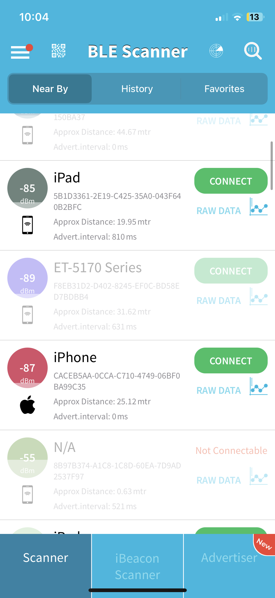
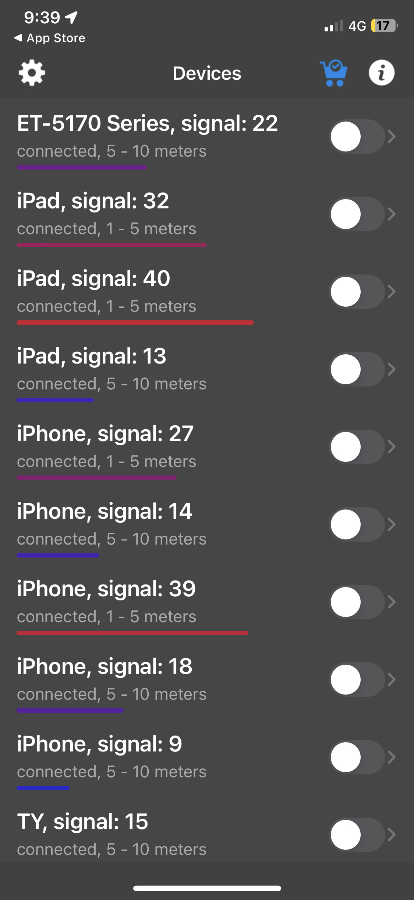

# BLE Scanners

Friday, 21 Feb 2025

*Originally published on my UNSW OpenLearning blog.*

I always asked myself, how did we go from sticks and stones to Bluetooth? Bluetooth plays such a huge role in our everyday lives, but we don't see people talking about how it works. Today, I have installed a few BLE scanners to test and experiment the overall integrity and safety of Bluetooth.

Upon downloading, I found many unfamiliar devices that were shown and tracked. Some were devices within the house while others were not. I found it interesting that my devices had Bluetooth on most of the time.

Upon this, I researched how Bluetooth works.

Devices are connected through a Bluetooth network via radio waves which are invisible due to them being outside the visible spectrum (400-700 nm). As a result, these signals are invisible to the naked eyes, thus we don't see the true effects of Bluetooth. They travel at frequencies of 2.4GHZ rather then 5GHZ. 2.4GHz provide further coverage and can travel through obstacles such as walls and doors while 5GHz provide stronger signals but are weaker when obstructed. This explains why the Bluetooth Scanner can detect things from 30metres away despite my room being closed.

Another thing I found interesting about Bluetooth works, how many devices with Bluetooth support don't interfere with one's signal. This is due to the fact that once two devices have connected, they will jump over 79 different frequency channels up to 1600 times a second. Bluetooth is probably the craziest thing we have created, yet is not acknowledged as it's so common in our everyday lives.
