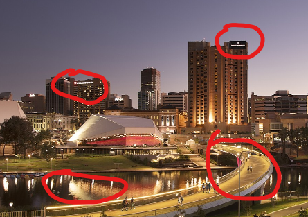
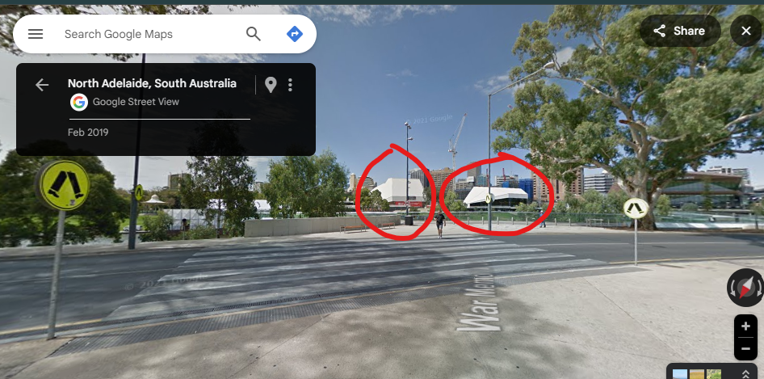
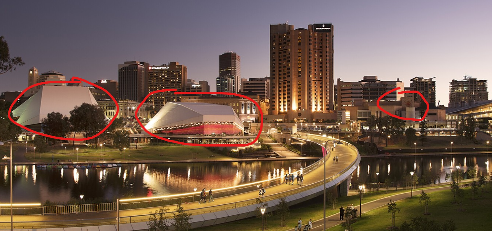
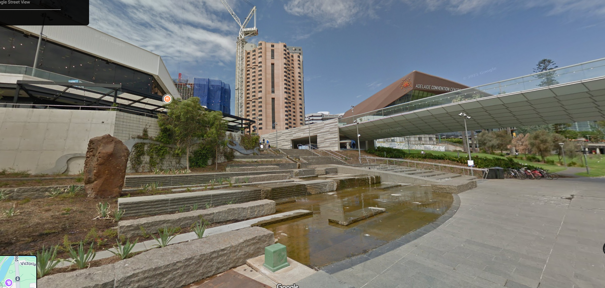
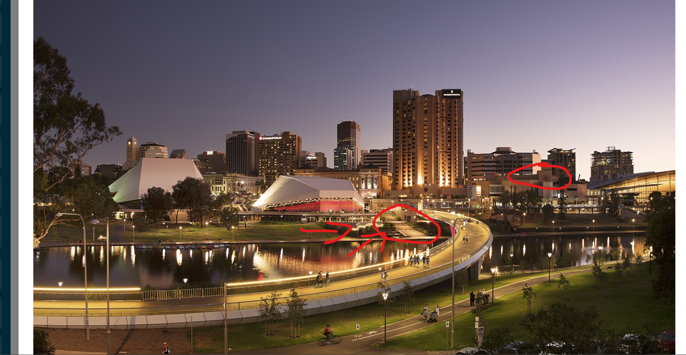

# Photo Detective

Saturday, 1 Mar 2025

*Originally published on my UNSW OpenLearning blog.*

I believe Mikayla's photo was taken in North Adelaide, Where the river is River Torrens. I found it through these steps

First I read the hotel names, which I saw stamford and Intercontinental hotel (I couldn't read the second one well so I searched continental hotel) and found that.

- I searched up where these hotels were and which places had them next to each other. I first determined this place to be Melbourne but using Google maps I could determine the exact place it was taken as I could not find the exact bridge upon checking near the area.

- I then found that these hotels were in Adelaide too, so upon finding it on google maps I found the exact bridge as well these peculiar shaped buildings

I wanted to double check so I searched intercontinental hotel adelaide and found this photo which was legit the same building at another view.

More confirmation I needed included this where I used the street views to view around the area and found this location, which are included in her photo.

Those stairs as well as the orange like symbol are in the exact photo

