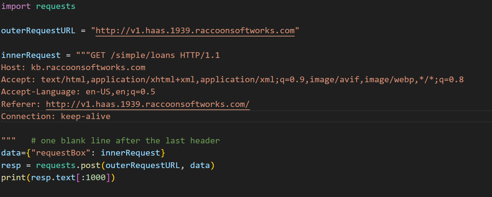

# W1 Reflection + Writeup

Friday, 26 Sep 2025

*Originally published on my UNSW OpenLearning blog.*

Reflection

This week was really fun, especially meeting Kris and seeing the CEO of Pearler talk to us. I really enjoyed the lectures however for the homework I had to self learn and collaborate with other peers to find the answer. At the start, I had no idea how to approach the V1 and V2 challenges but slowly but surely I had managed to get help from others in my tutorial and understand how it all worked. I didn't have to use python for V1 and V2 but as I got to V3 I realized I would have to implement a python script. Through V1 and V2 I had learnt how to utilize HTML headers to POST / GET information from specific sites like the one Kris gave us.

### V1:

This first activity allowed me to grasp the basics of html requests, specifically about how HTML requests worked and the general format. The goal was to find the flag, a specific key through experimenting and going through the URL paths. For this, we were given a starter code.

Which gave us an output of

HTTP/1.1 200 OK

Server: Werkzeug/3.0.2 Python/3.13.7

Date: Fri, 26 Sep 2025 06:08:40 GMT

Content-Type: text/html; charset=utf-8

Content-Length: 246

Connection: close

<h2>Welcome to the Knowledge Base</h2>

    Please remember not to allow any external uses to access this page!

    Please follow the following link to access the knowledge base data:

    <a href="/simple">Simple</a>

So seeing the URL path /simple, I decided to enter it. To enter, I had to change the GET / to GET /simple as the / meant I was at the start (the root of the website). Doing this changed the output.

I was given many URL paths, which I unfortunately brute forced until I found the flag in loans. This made me understand how URL paths work and more specifically how to access them with HTML requests.

Flag found: COMP1939{REDACTED}

### V2:

The second activity allowed me to learn about POST requests, another type of requests we can perform other then GET. We were given the same starter code but a different output.

With this, I was told that we had to login with user: admin and pass: admin. Originally I was confused but I reaslied this was a POST request. So i started constructing my HTML request, changing GET to POST / login. However, the format of user and password was what got me. I eventually got the format down yet it still said it was incorrect. That's when I realised that my content-length was wrong which heavily affects the request.

Flag: COMP1939{REDACTED}

### V3:

For v3, I had no idea and started self learning about python libraries such as requests and gain a decent understanding. I even used AI to ask questions about how to implement the script and was led to many answers such as regex and Beautiful Soup. I decided to do V1 and V2 again but with python, consolidating my understanding of the requests library. Unfortunately I couldn't get it.

### V1 python

I understood that requests.post basically sent key:value to v1.haas.1939.racconsoftworks.com upon reading the documentation, where the value was the HTML request I wrote previously for V1, and where key was requestBox, the name of the requestBox that allowed us to submit our HTML requests to.

Overall Week1 was quite fun especially seeing everyone back together! :). However it was definitely stressful for a week1 as I thought it was a big jump.
