# Week 2 Writeup + Reflection

Thursday, 2 Oct 2025

*Originally published on my UNSW OpenLearning blog.*

In Week 2, we were given 11 OSINT tasks to complete via HTB. Here is my following writeup for some of the ones I have completed.

## WRITEUPS

The Puppet Master: (Very Easy)

This task was labelled as an "Easy" task, which required researching skills and a prior knowledge on reverse image search. Here is how I completed this activity.

- Look at the evidence section, which contained a photo of a military armored vehicle. I was able to find the specific name of this vehicle through copying the image and pasting it into Google images, allowing me to reverse image search the details of the vehicle. This was quite straightforward.

- With google image search, I was able to find the name of the vehicle, seen in the image below.

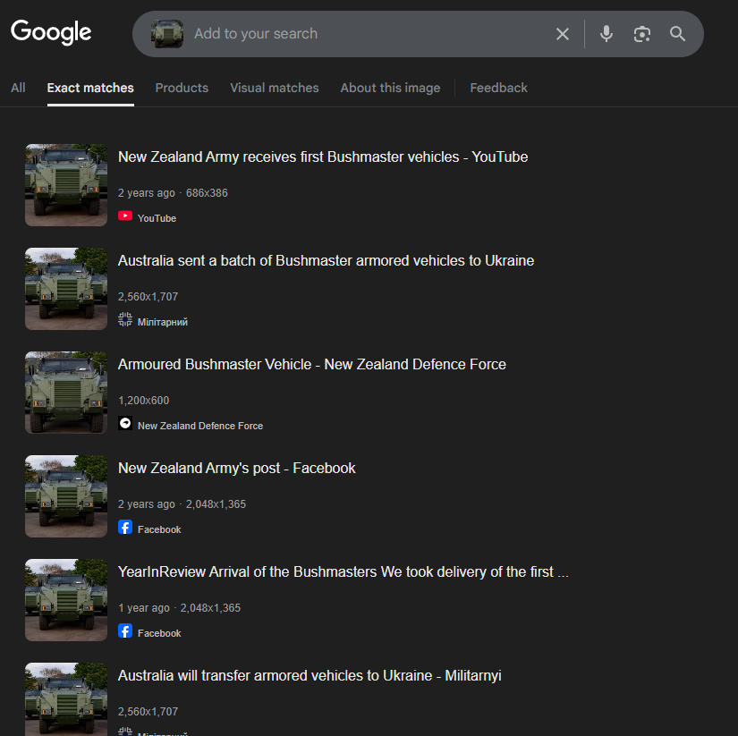

- Through the name, I was able to research and answer the other questions like the manufacturer of the vehicle, where the vehicle originated from etc. Through answering the questions, I was given the flag.

Social Media Investigation Hub (Very Easy)

We did this one in class, but it was essentially a website that contained questions where we were given the task to find the answers that were scattered across the website, showcasing our ability to locate information. It was fairly straightforward.

Infiltration: (Easy)

This task was quite enjoyable, where we were given the company name "Evil Corp LLC" and had to find information through searching social media sites. It required great researching skills.

1. My first approach was to search up "Evil Corp LLC", where I was led to a linked in page.

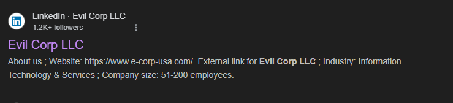

Accessing the page lead me to the company's profile, where the bio contained a "flag".

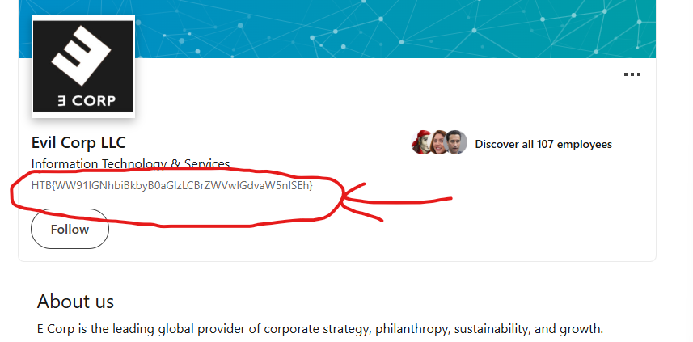

Of course, I tried to enter the following flag into HTB but it was invalid. I then looked at the format and realized it was a some sort of encoding string. (BASE 64). I asked Chat GPT to decipher it and it gave me the following message.

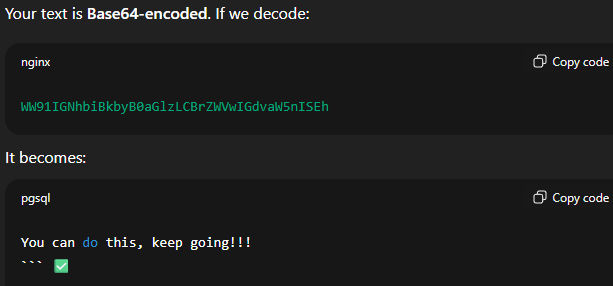

Of course, this lead me nowhere so I begin to check what was on google. I came across an instagram post under the name "eryn_mcmahon12". Looking closely at the image, I could see there was a flag located on the nametag on the left. Giving us the flag which worked!

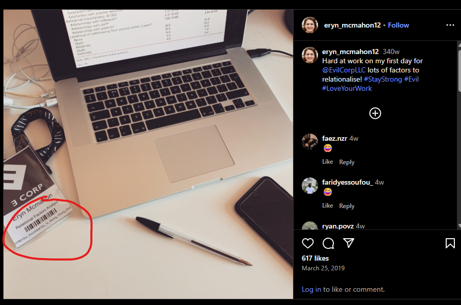

Easy Phish: (Easy, but felt Medium - HARD)

This one took a lot of time and understanding of DNS records, where we are given the website [https://secure-startup.com/lander](https://secure-startup.com/lander) and told to find the flag. However, upon entering the website, it seemed like it was a bought domain and had nothing valuable. However, this is where I decided to use the dig command we learnt in class, which allowed us to fetch information about a specified DNS server. I first did "dig -t TXT secure-startup.com" which essentially fetches TXT records from secure-startup. As you can see, there was an answer section that contained the first half of our flag. With this, I was confident that the second half was located somewhere within these DNS records.

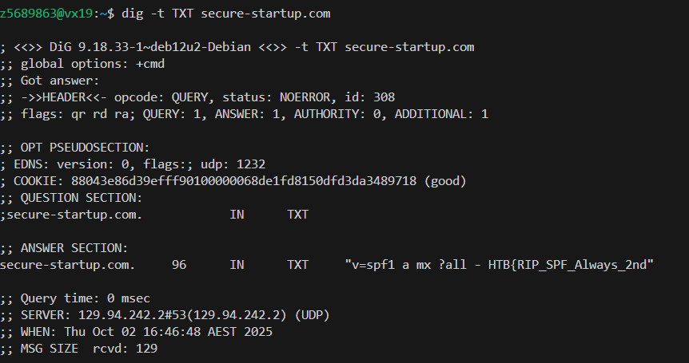

I then reread the description of the task, Customers of secure-startup.com have been recieving some very convincing phishing emails, can you figure out why?.

I decided to search about different systems such as DMARC, SPF and DKIM, especially after seeing "v=spf1 a mx ?all." I then tried to dig command DKIM, DMARC, AND SPF.

Eventually, when I tried DMARC I got the second half of the flag!.

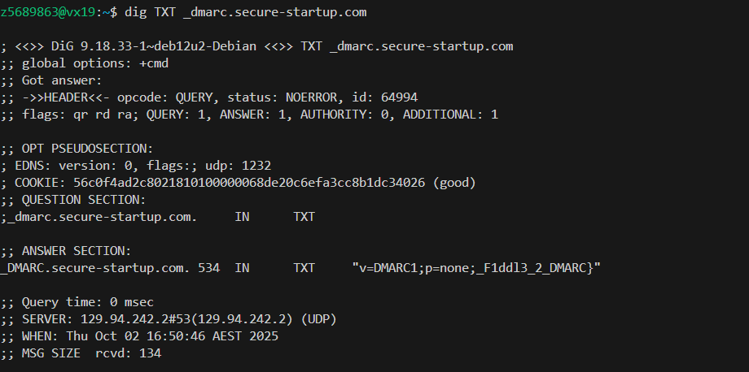

Missing in Action:  (Medium)

This one required serious OSINT skills and knowledge of wayback machine.

The task gave us "Roland Sanchez from Birmingham, UK" and how he went missing on a supposed "business trip".

1. The first thing I did was google his name and location, giving us a linked profile of an individual that matched our description. With this, we were given the name of the company he worked for.

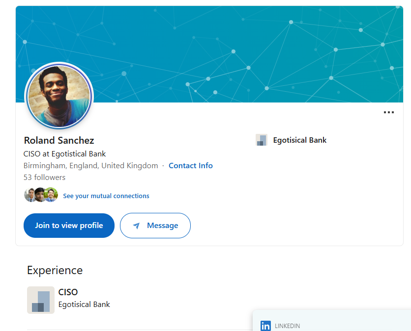

2. I then searched up CISO at Egotistical Bank, which lead me to a suspicious twitter page.

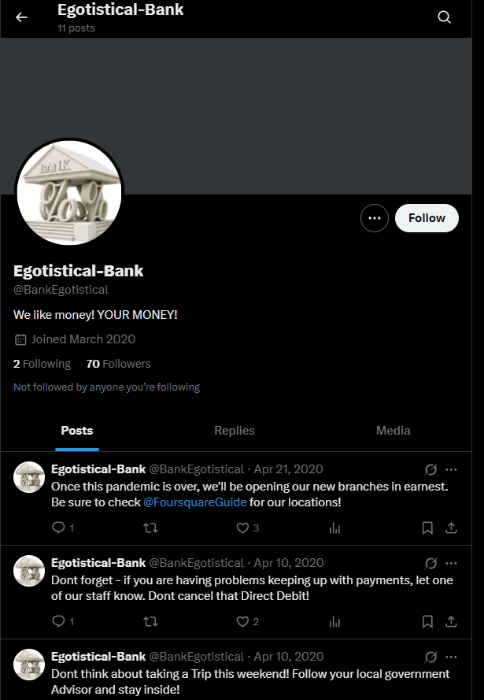

I scrolled down to find a message that said "Sorry - the website isn't quite ready yet. Our CISO jumped the gun slightly! We'll let you know when we move to actual hosting and not some free site". This showed me proof that this account was tied with Roland Sanchez as he worked as the CISO of the company.

3. I see FoursquareGuide mentioned so I instantly research about the company. It seems that it's a website where users can give reviews. I decided to google dork with the following. This means I want to find his name within the website foursquare.

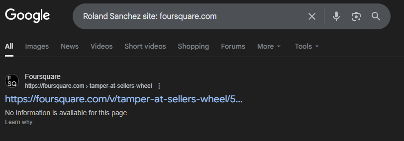

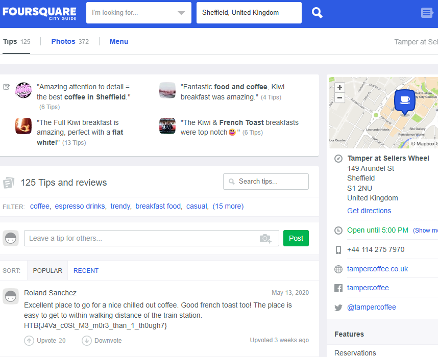

As you can see, we successfully found the flag!.

## Reflection

Week 2 Homework was really enjoyable and fun to do! I really enjoyed very aspect and learnt valuable skills such as google dorking and using dig to find DNS records!. Although some activities were hard to do, I enjoyed learning along the way. I would really like to google dork more for future activities as well as learn python libraries for future ethical hacking.
