# Week 3 homework + HTB proof.

Thursday, 9 Oct 2025

*Originally published on my UNSW OpenLearning blog.*

HTB user: adriancomp1939

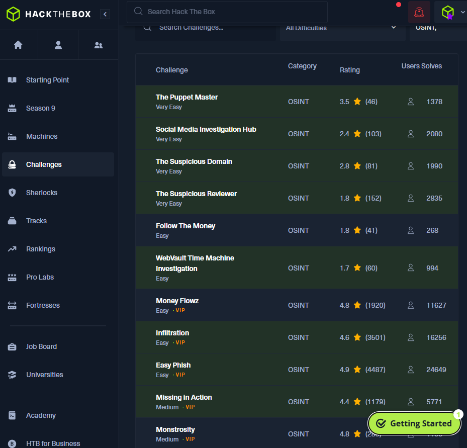

#### Week 3

##### Reflection:

This week, we delved into the complexities of cookies!. I found this week's exercises to be really fun. Learning how to use websites such as jwt.io and learning about JSON Web tokens was really interesting. Each exercise was unique and required a lot of thinking.

Overall, what I enjoyed the most was probably learning about the general structure of a JWT and how they work.

##### Writeup:

- [What's a JWT?](http://whats-a-jwt.1939.raccoonsoftworks.com/)

This was the first exercise, so I assumed it would be quite easy and straightforward which it was. When entering this site, you are led to a simple html page.

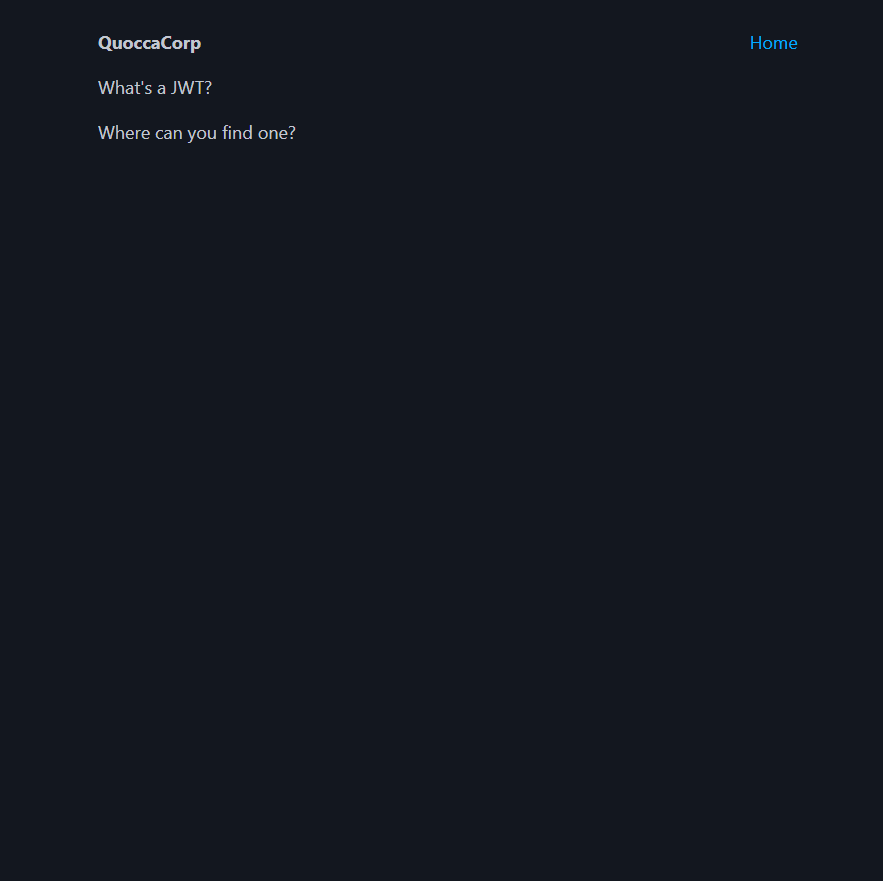

The webpage asks me "where can you find one" so I automatically assume I have to use developer tools, a feature that's built in on browsers such as google chrome.

Since we are dealing with cookies, to locate where my cookie is, we open developer tools and then go to Application, which is where website storage is located.

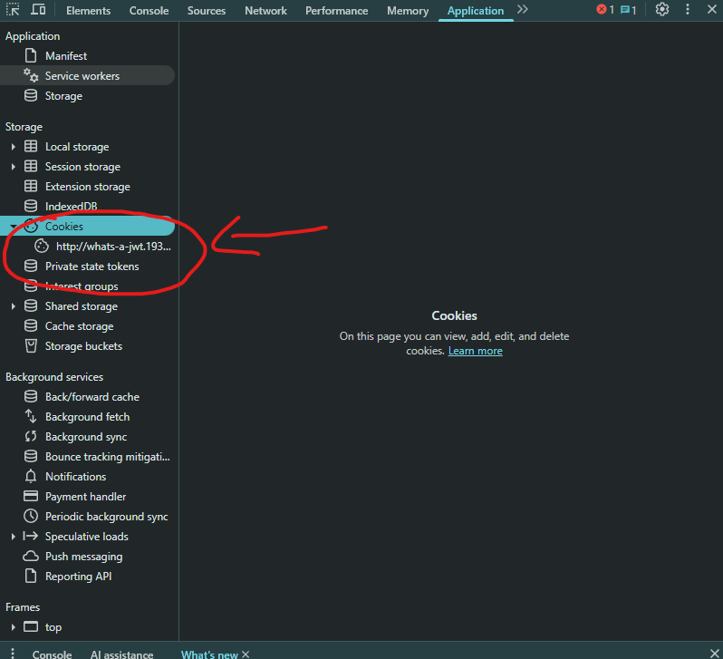

Through clicking the cookie, we can see a value. This string can be then placed into a JWT decoder such as jwt.io

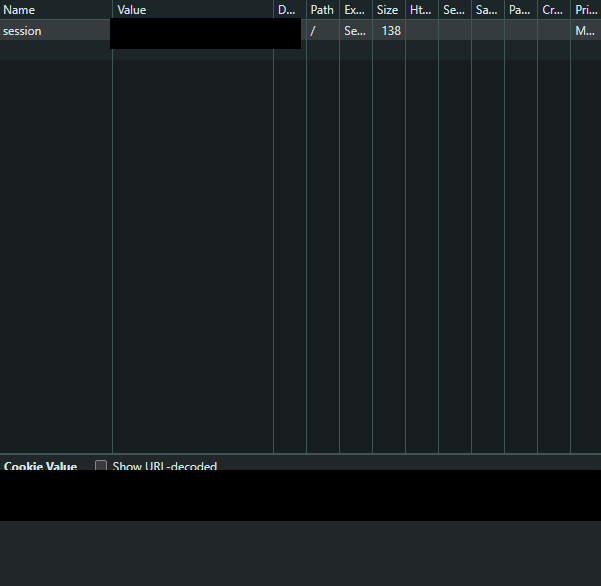

Keep in mind, you should NEVER show your cookie to anyone as they can impersonate you and log into your account. For educational purposes, this cookie is for the same for everyone.

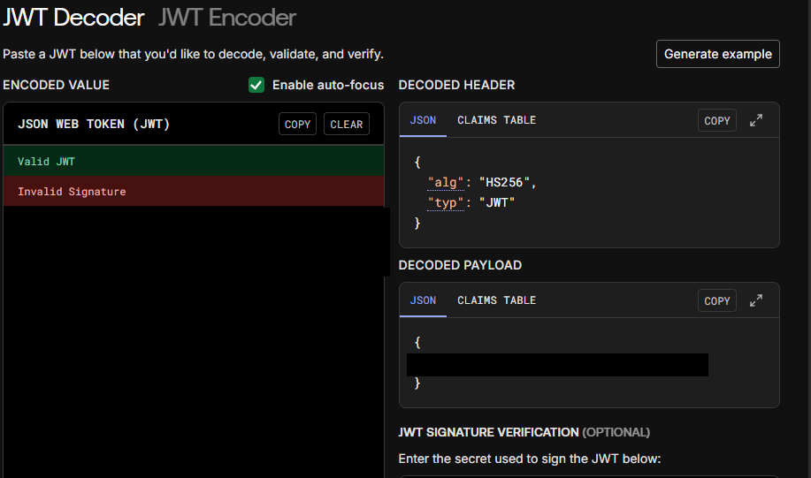

Pasting the code into the website jwt.io gives us a decoded payload which contains the flag for the first exercise!.

```
COMP1939{REDACTED}
```

- [Sales](http://sales.1939.raccoonsoftworks.com/)

This was quite a tricky one!. As we enter the website, we are presented with a log in page to Quocca Bank.

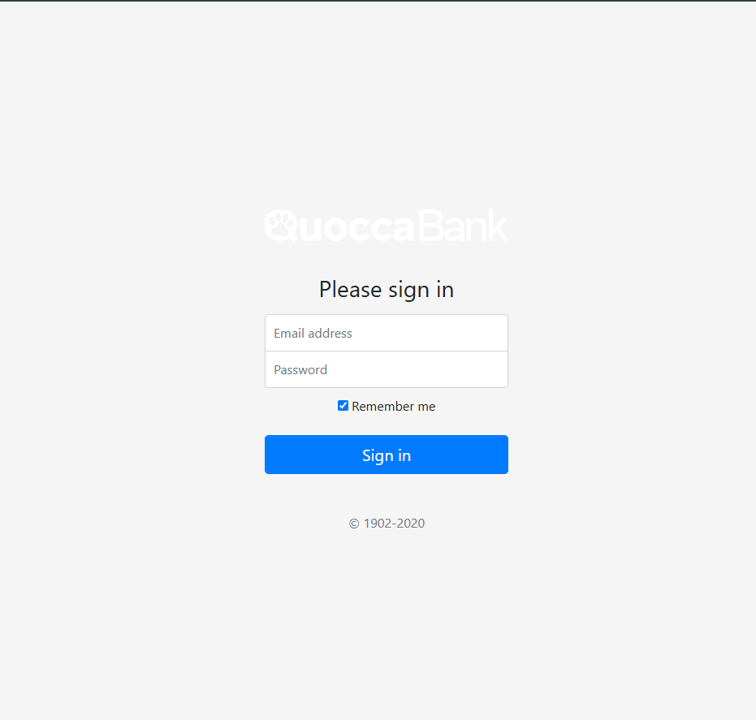

For all these challenges, my first instinct would be to open the application section in developer tools and pasting my cookie into JWT.io

However, upon pasting the cookie which seemed to be way shorter then a typical JWT, it showed that it was invalid.

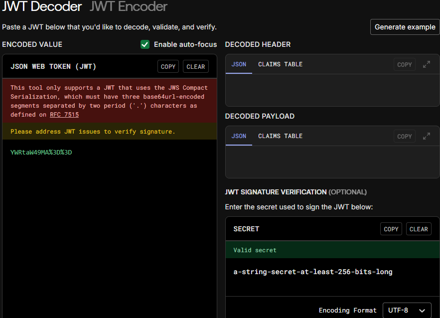

And then I remembered that base64 was also another type of encryption used. So I used cyberchef, a website that allowed me to decrypt.

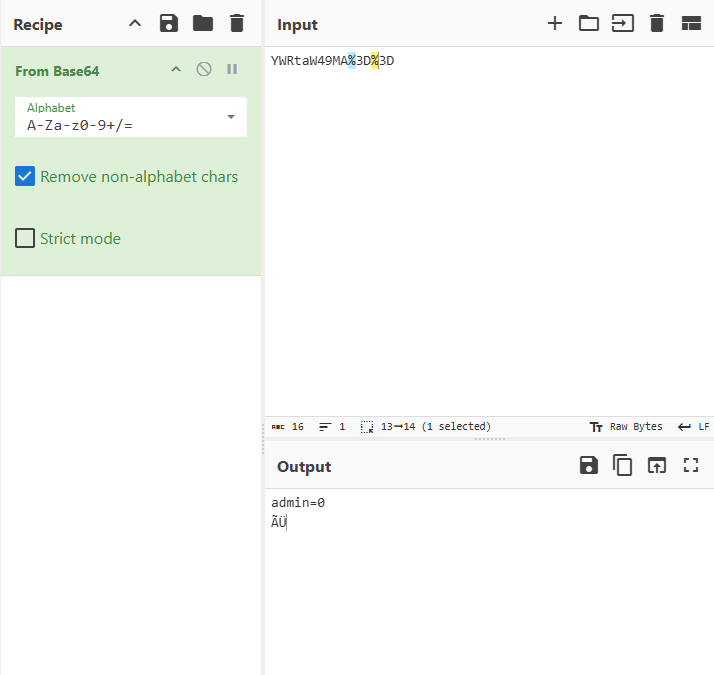

Through pasting the base64 into cyber chef, we are given admin=0 with weird letter variations. Through instinct, I decided to change admin=1 as 0 typically means false in coding while 1 means true. By changing admin=1 I believe I could trick the website into thinking I was admin.

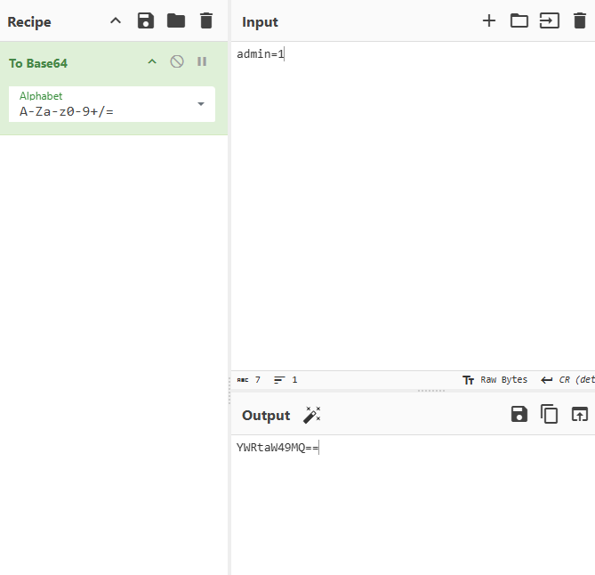

By pasting the output from cyber chef back into the cookies section in application, I refreshed the page and boom! I was in.


Flag:

### COMP1939{REDACTED}

- [Notes](http://notes.1939.raccoonsoftworks.com/)

Through entering the website, it gave us a very plain webpage consisting of "Hello bob@raccoonsoftworks.com There's no note left for you, try being an admin lol"

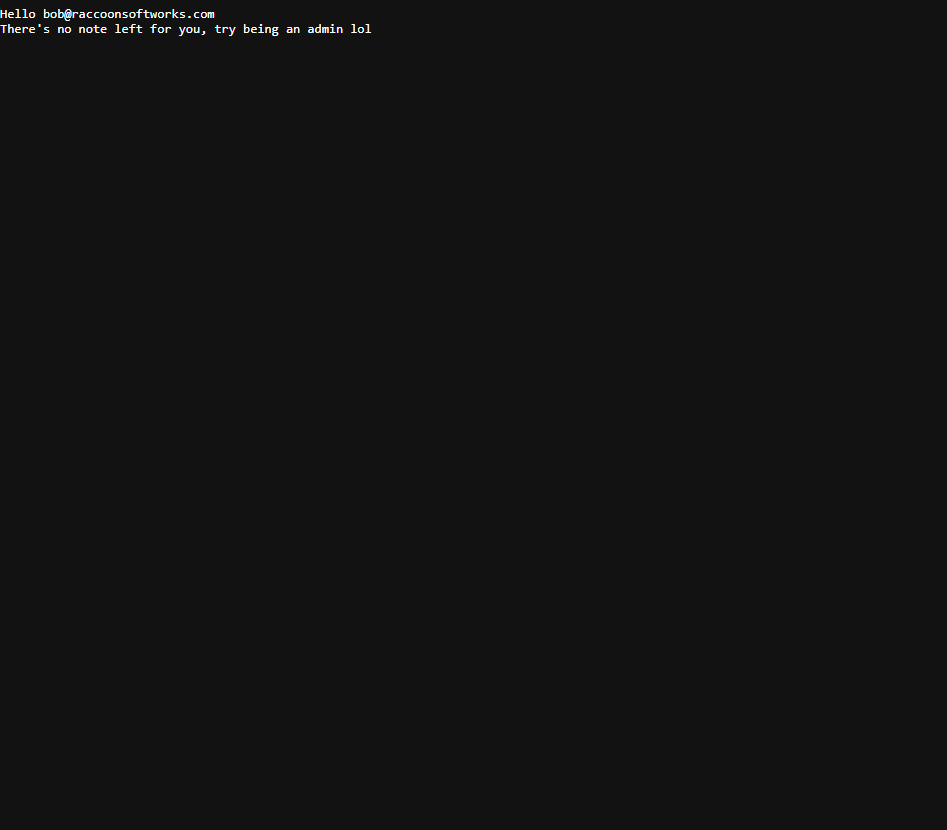

Once again, heading to the application section in developer tools and pasting the cookie into JWT.io for more information.

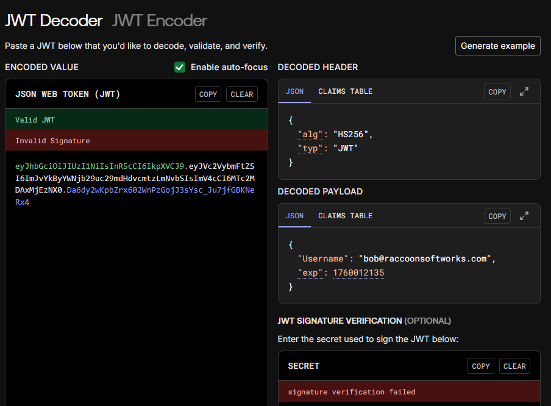

Through the JWT, we now see that this cookie has a "exp" and username. As the website told us to try being an admin, I try to change the name to admin@raccoonsoftworks.com. Pasting back the new cookie gave us this error.


With this error message, I thought about the exp field, and decided to modify by adding a bunch of numbers at the start as it's in seconds. With this, I was able to paste the new cookie and get the flag.

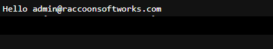

##### Social:

With OpenAI's latest video generation model Sora 2, the dangers of AI become more prominent as these AI generated videos seem incredibly real and convincing, a huge improvement to the previous Veo 3 created by Google. As AI advances, cyber threats become to emerge as scams including identity theft become harder to distinguish!.

I have personally used Sora 2 through a VPN and the fact that everyone can use it with no limitations (only an access code), there are so many possibilities of how Sora 2 can be manipulated and used as a tool for scammers to lure older age groups especially the elderly. Even I had a hard time realising whether or not some of the AI generated videos on Sora 2 were real or not.

Dangers that come with the AI include cyber threats including political views and fake crimes which can spread like wildfire. The amount of people that can't distinguish between AI generated videos and real videos is astonouishing and scary.
