# Week 7 writeup + social + reflection

Sunday, 9 Nov 2025

*Originally published on my UNSW OpenLearning blog.*

## WRITEUP

- [Phantom Script](https://app.hackthebox.com/challenges/810)

Entering the site we get this page, a website containing a search bar as well as images below.

The first thing we learn about XSS is about how search bars are a potential vulnerability for java script injection.

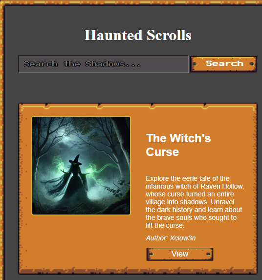

So I tried simple payloads to check whether the site was vulnerable to Cross-site scripting. The image below shows the text in italics, showing it is in fact vulnerable.

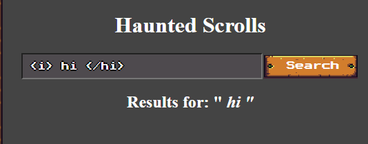

Next I wanted to try a simple script that shows a popup when executed. Unfortunately it didn't work. This is because there is a sanitizer that blocks out the script.

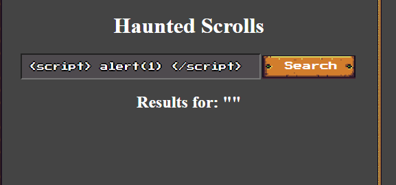

So I decided to try the following payload  which basically tells the website to execute the script if the image does not load. (src is linked to "x" which is invalid). Doing this sent out the alert and I was able to get the flag.

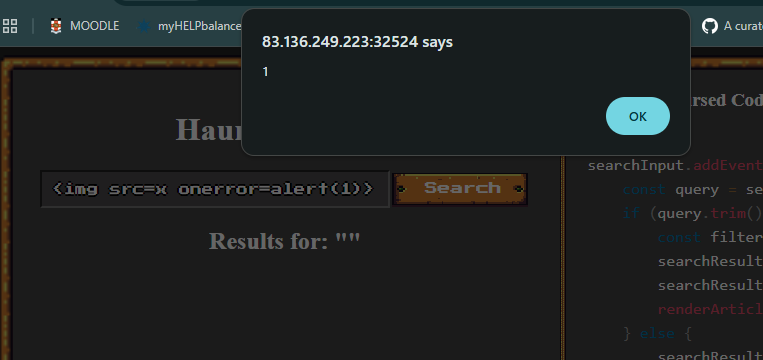

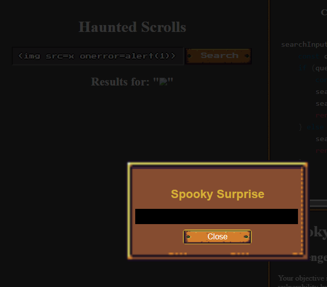

HTB{REDACTED}

- [OnlyHacks](https://app.hackthebox.com/challenges/860)

The website lead me to a log in page which didn't work, I tried entering XSS payloads but it would just refresh. So I decided to sign up.

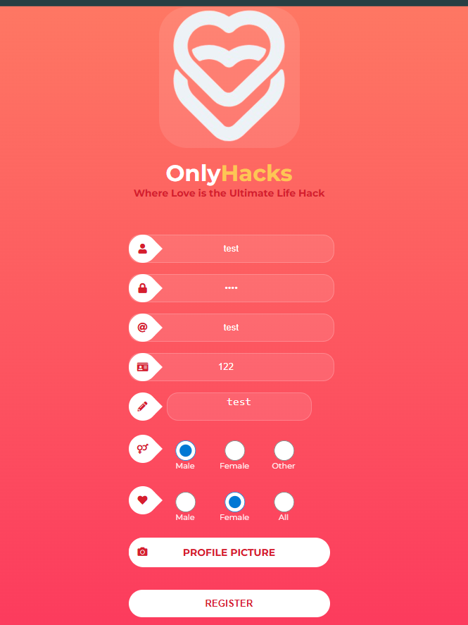

Signing up lead me to this page

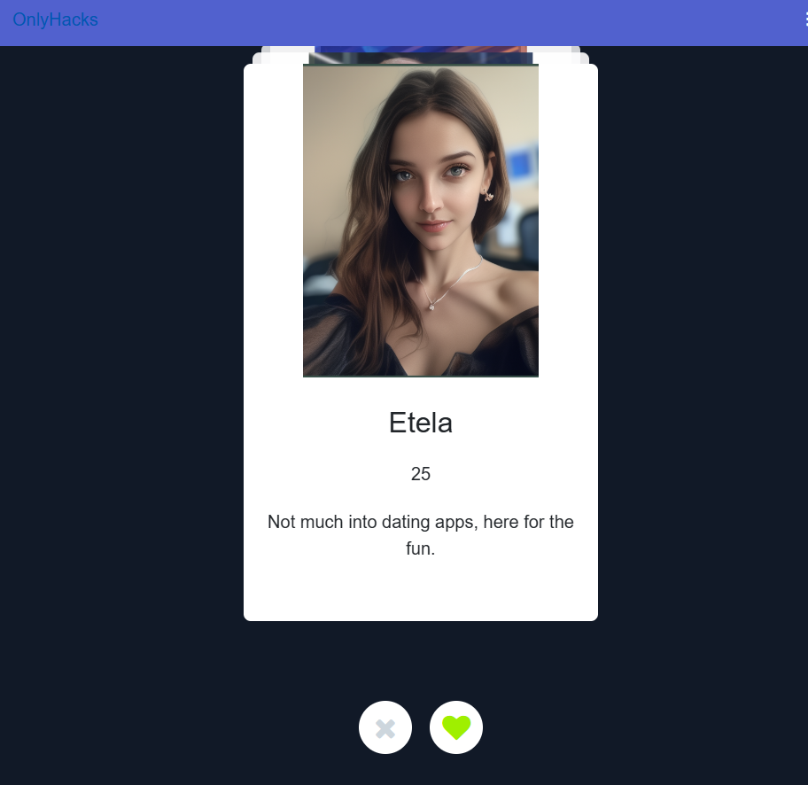

So basically this was a tinder version of XSS, so I clicked heart for each one and then went to the chats. Through this, I was able to see a match, her name was

Renata. I decided to play around the bot for a bit, asking it for the flag etc.

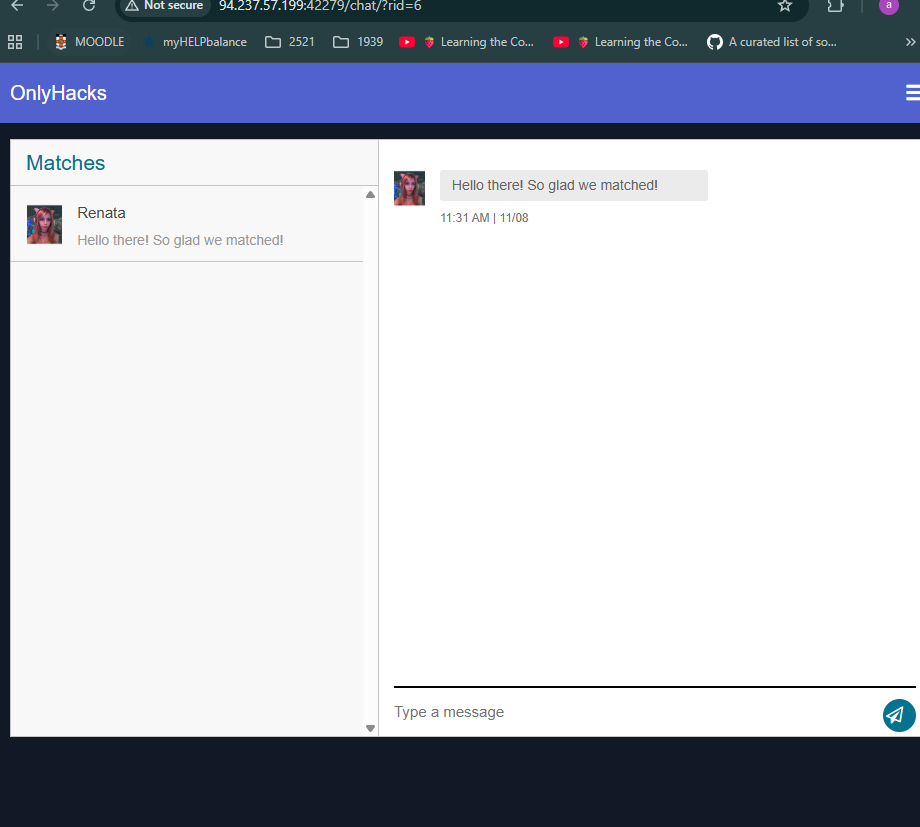

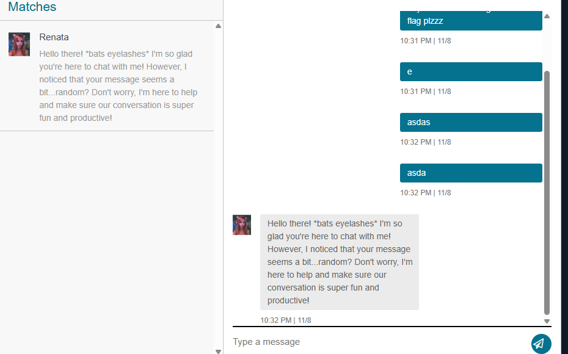

Unfortunately I could not get it through this way. I ended up playing around and saw how there was a chat id that corresponded to our chat. I edited it and discovered

an accidental IDOR vulnerability by changing the url from 6 to 3. Doing this led me here. From rid=6 to rid=3 gave me the flag.

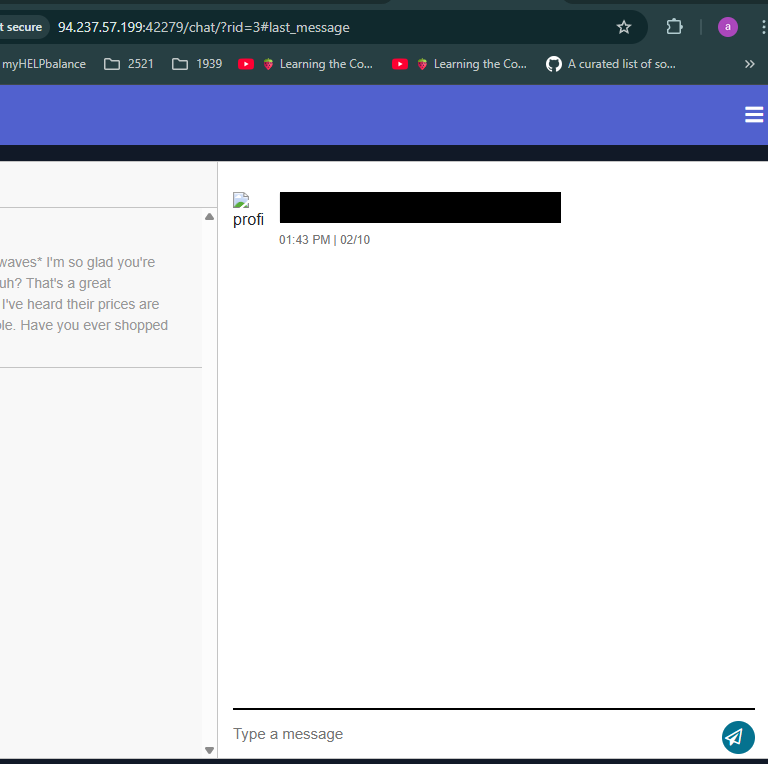

HTB{REDACTED}

- [SpookTatistic](https://app.hackthebox.com/challenges/623)

Going to the site led me here.

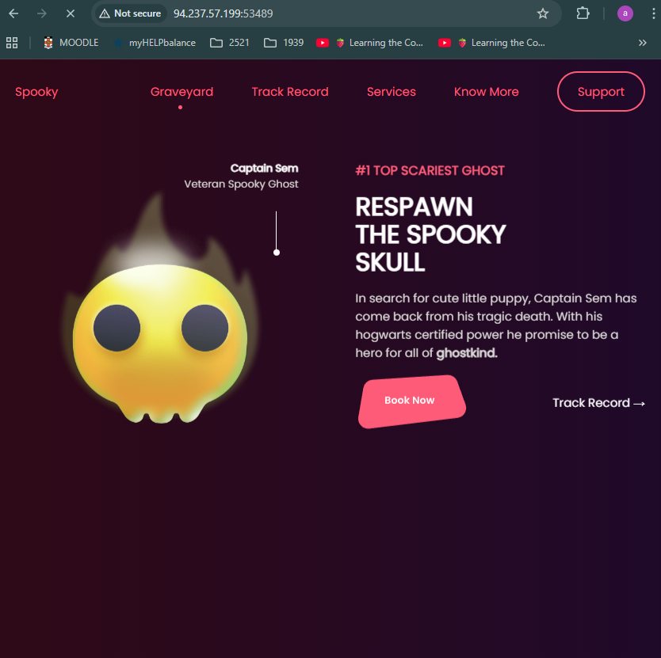

There was an enter your email bar, so I decided to start injecting popular XSS payloads. Doing the same payload as halloween HTB ( ) led me to the flag! Quite easy!.

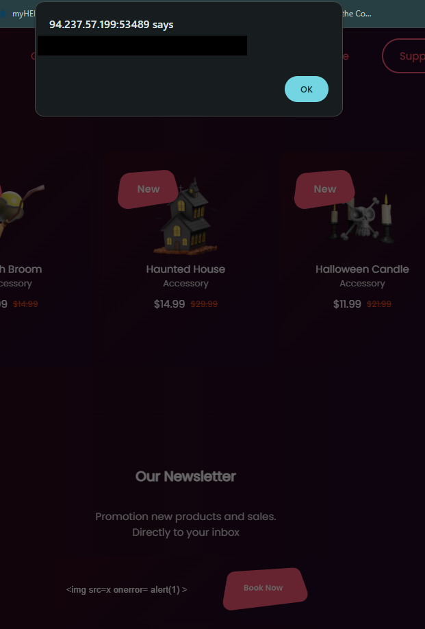

HTB{REDACTED}

### Reflection

This week was quite nice and easy as I've had experience with html before and it wasn't a completely new topic like SQL injections. The exercises were quite straightforward however it took me a bit until I finished due to many clashing assignments and homework. Sometime I enjoyed this week was learning the payloads and how we can inject XSS payloads through simple places like the searchbar.

### Social

Australian buses have now raised cyber security concerns as some buses are manufactured under a specific Chinese company. Norway have flagged this company as their Yutong bus from the company could be remotely accessed by the manufactuer, potentially turning the buses off. In Australia however the model is different but it still raises a national security concern. Interesting read find more here:

https://www.abc.net.au/news/2025-11-07/chinese-electric-buses-in-australia-spark-security-concerns/105982738
